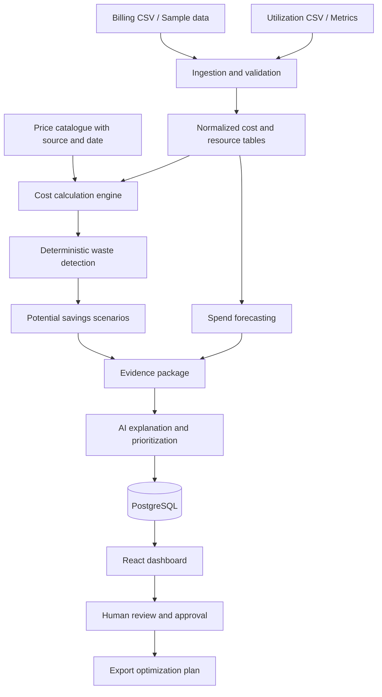

# CloudPilot AI — AI-assisted Cloud Cost and Resource Optimization

## 1. Product summary

CloudPilot AI is a local-first FinOps and cloud optimization assistant. It ingests cloud billing exports and resource utilization data, identifies possible waste, forecasts spend, calculates transparent savings scenarios, and produces approval-ready optimization plans.

**It must not silently modify cloud resources.** The MVP uses sample billing data and simulated resource inventories. Real cloud integrations are read-only by default. Any future write capability must be separately configured, restricted to a test account, and require human approval.

### Recruiter-facing problem statement
"Cloud bills are difficult to interpret and resource waste is easy to miss. CloudPilot AI combines billing, utilization and pricing data to explain cost drivers, forecast spend and produce evidence-backed optimization recommendations."

### Target roles
- Junior Cloud Engineer
- Cloud Operations / Automation Engineer
- DevOps Engineer
- AI Application Engineer
- FinOps / Cloud Analyst

## 2. MVP scope

1. Upload a standardized CSV billing export.
2. Import resource utilization metrics from CSV.
3. Normalize billing records into a common schema.
4. Categorize spend by service, project, environment, region and tag.
5. Detect possible idle/underutilized resources using configurable deterministic rules.
6. Estimate potential savings using explicit assumptions and price inputs.
7. Forecast monthly spend using a baseline statistical model.
8. Ask an AI agent to explain findings in plain language and propose next steps.
9. Generate a prioritized optimization report with evidence, assumptions, risk and confidence.
10. Require human review and approval before marking a recommendation as actionable.
11. Export a PDF/CSV/Markdown report.
12. Include synthetic sample data and tests so recruiters can reproduce results without cloud credentials.

## 3. Non-goals for MVP

- No automatic deletion of resources.
- No automatic resizing or stopping of real cloud resources.
- No claim of guaranteed savings.
- No AI-generated prices without a source.
- No cloud admin credentials.
- No vendor-specific dependency in the core data model.
- No complex multi-cloud connector in the first milestone.

## 4. Architecture



**Design principle:** deterministic code calculates costs and savings. AI explains the results and helps prioritize; it must not invent billing amounts or prices.

## 5. Recommended technology

| Layer | Choice | Reason |
|---|---|---|
| Backend | Python 3.12+, FastAPI, Pydantic | Typed APIs and Python portfolio |
| Data processing | Pandas or Polars | CSV normalization and analysis |
| Database | PostgreSQL + SQLAlchemy + Alembic | Persist normalized data and recommendations |
| Forecasting | statsmodels or scikit-learn baseline | Explainable forecasting |
| AI agent | Typed service; LangGraph optional | Controlled reasoning workflow |
| Frontend | React + TypeScript + Vite | Recruiter-friendly dashboard |
| Charts | Recharts | Cost trends and breakdown |
| Local runtime | Docker Compose | Reproducible setup |
| Testing | pytest, httpx, Playwright optional | Verifiable results |
| CI | GitHub Actions | Automated quality checks |

## 6. Repository layout

```text
cloudpilot-ai/
├── backend/
│   ├── app/
│   │   ├── main.py
│   │   ├── api/routes/
│   │   ├── core/config.py
│   │   ├── schemas/
│   │   ├── models/
│   │   ├── services/ingestion/
│   │   ├── services/normalization/
│   │   ├── services/costing/
│   │   ├── services/detection/
│   │   ├── services/forecasting/
│   │   ├── services/recommendations/
│   │   ├── llm/
│   │   └── db/
│   ├── tests/
│   └── pyproject.toml
├── frontend/
├── data/
│   ├── sample/
│   ├── schemas/
│   └── README.md
├── pricing/
│   ├── catalogue/
│   └── sources.md
├── docs/
├── scripts/
├── docker-compose.yml
├── .env.example
├── .gitignore
└── README.md
```

## 7. Data inputs and common schema

Support a documented generic CSV first. Later, add adapters for AWS Cost and Usage Report (CUR), AWS Cost Explorer exports, Azure Cost Management exports, or OpenCost exports. Do not assume provider export columns are identical.

### Generic billing CSV columns
- `usage_date` (ISO date)
- `provider` (`aws|azure|gcp|sample`)
- `account_id` (masked/demo identifier)
- `service`
- `resource_id`
- `region`
- `environment` (`dev|test|staging|prod|unknown`)
- `project`
- `usage_quantity`
- `usage_unit`
- `cost_amount`
- `currency`
- `tag_team`
- `tag_owner`

### Generic utilization CSV columns
- `timestamp`
- `resource_id`
- `cpu_avg_pct`
- `cpu_p95_pct`
- `memory_avg_pct`
- `memory_p95_pct`
- `network_in_bytes`
- `network_out_bytes`
- `storage_used_pct`
- `sample_window_minutes`

Validate dates, numeric ranges, currency, missing IDs, duplicate rows and unsupported units. Keep original rows or source file metadata for auditability.

## 8. Data model

Implement tables:

- `billing_imports`: source filename, provider, imported_at, row_count, validation_status.
- `cost_records`: date, provider, service, resource_id, region, environment, project, quantity, unit, amount, currency, tags, import_id.
- `resource_metrics`: resource_id, timestamp, cpu/memory/network/storage metrics, source.
- `price_entries`: provider, service, region, SKU, unit, unit_price, currency, effective_from, effective_to, source_url, retrieved_at.
- `optimization_findings`: resource_id, finding_type, evidence_json, severity, detected_at.
- `savings_scenarios`: finding_id, baseline_cost, proposed_cost, estimated_savings, currency, assumptions_json.
- `forecasts`: period, predicted_cost, lower_bound, upper_bound, method, created_at.
- `recommendations`: title, explanation, risk, confidence, evidence_ids, status.
- `approvals`: recommendation_id, decision, reviewer, comment, decided_at.

Use Decimal for money calculations, not binary floating point. Never combine different currencies without an explicit exchange-rate source and conversion date.

## 9. Cost and savings logic

All calculations must be transparent and reproducible.

Example monthly resource cost:
`monthly_cost = hourly_unit_price * billable_hours`

Example scenario:
`estimated_savings = baseline_monthly_cost - proposed_monthly_cost`

For idle-resource detection, use configurable rules such as:
- CPU p95 below a chosen threshold for a minimum observation period.
- Memory p95 below a threshold, with workload-specific safeguards.
- Resource has no traffic or usage during the observation window.
- Resource is tagged as non-production or has explicit owner confirmation.

**Do not recommend deletion solely because CPU is low.** Some resources are intentionally idle for failover, backups, compliance, batch jobs or seasonal demand. Mark recommendations as candidates requiring owner review.

Every savings estimate must display:
- Source cost records and time window.
- Price source and effective date.
- Utilization observation window.
- Assumptions and exclusions.
- Estimated savings range where uncertainty exists.
- Risk and required validation.

## 10. AI agent workflow

The AI receives a bounded, structured analysis package generated by deterministic code. It may:
- Explain why a finding was raised.
- Summarize the cost driver.
- Compare approved scenarios.
- Prioritize by estimated impact and risk.
- Draft a human-readable action plan.
- Ask for missing context.

It must not:
- Invent price data or savings.
- change cloud resources.
- infer that an untagged resource is unused.
- treat user-provided CSV text as trusted instructions.
- output a recommendation without evidence IDs and assumptions.

### Required structured output

```json
{
  "executive_summary": "Summary grounded in the supplied analysis",
  "priority_findings": [
    {
      "finding_id": "finding-001",
      "explanation": "Why this resource was flagged",
      "evidence_ids": ["cost-001", "metric-019"],
      "assumptions": ["Utilization sample covers 30 days"],
      "risk": "medium",
      "recommended_next_step": "Ask owner to validate workload schedule"
    }
  ],
  "unknowns": ["Resource owner is not known"],
  "human_review_required": true
}
```

Validate output with Pydantic. Reject unknown finding IDs and any numeric price/savings claims not present in the analysis package.

### Suggested AI system instruction
"You are a cloud cost analysis assistant. Use only supplied billing, price and utilization data. Never invent prices, currency conversions or savings. Cite finding and evidence IDs. State assumptions and uncertainty. Low utilization is not proof that a resource is unnecessary. Do not execute cloud operations. Recommendations require human review."

## 11. API contract

| Method | Endpoint | Purpose |
|---|---|---|
| POST | `/api/imports/billing` | Upload billing CSV |
| POST | `/api/imports/utilization` | Upload utilization CSV |
| GET | `/api/imports/{id}` | Import status and validation |
| GET | `/api/costs/summary` | Spend overview |
| GET | `/api/costs/trends` | Daily/monthly trends |
| GET | `/api/costs/breakdown` | Service/project/region breakdown |
| POST | `/api/analysis/run` | Run deterministic analysis |
| GET | `/api/findings` | List optimization findings |
| GET | `/api/findings/{id}` | Finding evidence and scenario |
| POST | `/api/forecasts/run` | Generate forecast |
| GET | `/api/forecasts` | Forecast results |
| POST | `/api/reports/generate` | Generate AI-assisted report |
| POST | `/api/recommendations/{id}/approve` | Record human approval |
| POST | `/api/recommendations/{id}/reject` | Record rejection |
| GET | `/api/exports/{id}` | Download report |

## 12. Dashboard pages

1. **Overview:** total spend, month-over-month change, top services, forecast and data freshness.
2. **Cost Explorer:** time series and filters by provider, service, project, region and environment.
3. **Resource Health:** utilization table with observation window and owner tags.
4. **Optimization Findings:** possible waste, evidence, risk and savings range.
5. **AI Advisor:** explanation, unknowns, assumptions and prioritized action plan.
6. **Forecasts:** predicted spend and uncertainty band.
7. **Imports:** uploaded files, validation errors and data lineage.
8. **Audit:** approvals, rejected suggestions and report history.

Avoid showing invented live metrics. Clearly label synthetic sample data in the demo.

## 13. End-to-end user workflow

1. User opens CloudPilot AI and loads sample data or uploads a supported CSV.
2. Backend validates and normalizes billing and utilization records.
3. Dashboard shows data quality, currency and observation window.
4. Deterministic engine calculates spend breakdowns.
5. Rule engine identifies possible idle or over-provisioned resources.
6. Scenario calculator estimates savings from documented price inputs.
7. Forecast service predicts future spend and shows uncertainty.
8. AI advisor explains findings using evidence IDs and assumptions.
9. User reviews each finding and marks approve, reject or needs-owner-review.
10. User exports a cost optimization report and CSV action plan.
11. Audit page records the decision and source data.

## 14. Build workflow / milestones

### Milestone 0 — Planning and sample data
- Create repository and project issues.
- Define generic billing and utilization schemas.
- Create synthetic sample dataset with clear labels.
- Document currency and pricing assumptions.

**Exit check:** sample files pass schema validation and include deliberately malformed rows for tests.

### Milestone 1 — Backend and ingestion
- Create FastAPI app and configuration.
- Add CSV upload endpoints.
- Validate required columns, dates, amounts, currencies and duplicates.
- Persist import metadata and normalized records.
- Return row-level validation errors.

**Exit check:** valid CSV imports; invalid CSV reports precise errors without corrupting data.

### Milestone 2 — Cost analytics
- Implement Decimal-based aggregations.
- Add spend by service, project, region and environment.
- Add trend and top-cost-driver APIs.
- Test totals against hand-calculated fixtures.

**Exit check:** totals and groupings match known test cases.

### Milestone 3 — Resource analysis and savings scenarios
- Import utilization records.
- Implement configurable detection rules.
- Require minimum observation window.
- Create price catalogue with source/effective dates.
- Calculate baseline and proposed costs with explicit assumptions.

**Exit check:** every finding links to evidence and every savings number can be reproduced.

### Milestone 4 — Forecasting
- Start with a transparent baseline such as moving average or seasonal naive forecast.
- Add train/test split and error metrics (MAE/MAPE where appropriate).
- Show prediction intervals or clearly explain when unavailable.
- Avoid overclaiming accuracy with small datasets.

**Exit check:** forecast is reproducible and evaluated against held-out sample periods.

### Milestone 5 — AI advisor
- Build LLM provider adapter (Ollama/OpenRouter).
- Send only normalized findings and calculations.
- Enforce typed JSON output and evidence IDs.
- Add timeout, retries, redaction and fallback.
- Test prompt injection embedded in CSV descriptions.

**Exit check:** AI explains findings without changing computed totals or inventing savings.

### Milestone 6 — Frontend
- Build overview, cost explorer, findings, AI advisor, forecast and imports pages.
- Add filters and data freshness indicators.
- Clearly label sample data.
- Add export buttons and approval history.

**Exit check:** recruiter can import sample files and explore the complete workflow in the browser.

### Milestone 7 — Quality and release
- Add unit, integration and API tests.
- Add GitHub Actions for lint, type checks and tests.
- Add screenshots, architecture diagram and demo dataset.
- Document data formats, limitations, assumptions and security.
- Tag `v1.0.0`.

## 15. Acceptance criteria

Portfolio-ready when:

- `docker compose up --build` starts the app.
- Sample CSV imports successfully.
- Invalid data produces useful validation errors.
- Currency is never silently mixed.
- Spend totals match known fixtures.
- Every finding links to source cost and utilization evidence.
- Every savings estimate shows assumptions and price provenance.
- Forecast includes evaluation and limitations.
- AI output is schema-validated and cannot modify calculated values.
- No cloud resource is changed by the application.
- Approval/rejection decisions are auditable.
- README contains a repeatable 5-minute demo.

## 16. Security and data quality requirements

- Do not request cloud write credentials for MVP.
- If adding a provider connector, use read-only permissions and a dedicated test account.
- Never commit cloud keys or billing data containing sensitive identifiers.
- Mask account identifiers in screenshots and demo exports.
- Treat uploaded CSV contents as untrusted data and guard against prompt injection.
- Validate file size, type, encoding, row count and numeric ranges.
- Use parameterized queries and safe file handling.
- Use Decimal for monetary values.
- Store price source, retrieval date and effective period.
- Keep an audit trail of imports, analysis runs and approvals.

## 17. Demo script for recruiters

1. Open dashboard showing clearly labelled synthetic sample data.
2. Upload sample billing CSV and utilization CSV.
3. Show import validation and data freshness.
4. Explore monthly spend and top cost drivers.
5. Run deterministic optimization analysis.
6. Open one finding and inspect its evidence and assumptions.
7. Show estimated savings calculation and price source.
8. Run AI advisor and inspect evidence-linked explanation.
9. Approve or reject the recommendation for the report.
10. Generate and download the optimization report.
11. Show automated tests and GitHub Actions passing.

## 18. Suggested resume bullets (use only after implementation)

- Developed a cloud cost analytics platform using FastAPI and Python to normalize billing and utilization data, identify potential resource waste and generate transparent optimization scenarios.
- Integrated an evidence-grounded AI advisor for cost findings, forecasting explanations and human-reviewed optimization plans.

## 19. Instructions for another AI coding agent

Build this repository in milestones. Do not generate the entire application in one response. First create `docs/IMPLEMENTATION_PLAN.md`, `docs/ARCHITECTURE.md`, `docs/DATA_DICTIONARY.md` and `docs/THREAT_MODEL.md`. Then implement Milestone 1 only, run tests, explain changed files and commands, and wait for approval before moving to the next milestone.

For each milestone:
- Make small, reviewable changes.
- Run tests and report actual results.
- Never invent successful test results or benchmark values.
- Keep `.env` and cloud credentials out of Git.
- Ask before adding paid services.
- Keep cloud integrations read-only unless explicitly approved for a separate test account.
- Label synthetic data and assumptions.
- Never let an LLM invent cost or savings numbers.
- Update README and progress checklist after each milestone.
