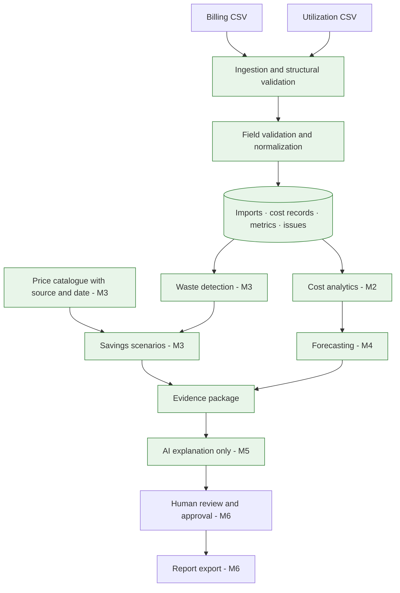

# CloudPilot AI

**AI-assisted cloud cost and resource optimization — local-first, evidence-first, and safe by design.**

CloudPilot AI ingests cloud billing and utilization exports, validates them with
row-level precision, stores exact-decimal records, and turns them into spend
analytics, evidence-backed waste findings, reproducible savings scenarios and
transparent spend forecasts. The AI advisor and the approval workflow arrive in
later milestones.

> **Status: Milestones 1–4 (ingestion, cost analytics, waste detection and
> forecasting) are complete.** The AI advisor, dashboard and approvals are
> intentionally not built yet — see [Roadmap](#roadmap).
>
> **All sample data and demo prices are synthetic.** The application holds no
> cloud credentials and cannot create, resize, stop or delete any cloud resource.

---

## The problem

Cloud bills are difficult to interpret and waste is easy to miss. Recruiters and
hiring managers can reproduce every result in this repository in about five
minutes: upload the synthetic billing and utilization files, inspect validation
quality, and see how money is stored exactly rather than through floating point.

The end goal is a FinOps assistant that explains cost drivers, forecasts spend,
and produces **evidence-backed, human-reviewed** savings recommendations. An LLM
will only ever explain numbers that deterministic code already computed.

## What works today

| Capability | Status |
|---|---|
| Generic billing CSV ingestion with row-level validation | ✅ Milestone 1 |
| Generic utilization CSV ingestion with row-level validation | ✅ Milestone 1 |
| Exact `Decimal` money storage (scaled `BIGINT`, no floats) | ✅ Milestone 1 |
| Structural + field + relationship validation, duplicate detection | ✅ Milestone 1 |
| Append-only import audit trail (SHA-256, row counts, raw rows) | ✅ Milestone 1 |
| Paginated import/issue/record inspection API | ✅ Milestone 1 |
| Alembic migrations, SQLite and PostgreSQL, Docker Compose | ✅ Milestone 1 |
| Spend summary, breakdown and trends with exact Decimal aggregation | ✅ Milestone 2 |
| Currency-partitioned totals, business-key de-duplication | ✅ Milestone 2 |
| Idle-resource detection with observation-window minimums | ✅ Milestone 3 |
| Rightsizing using sourced catalogue prices and explicit SKUs | ✅ Milestone 3 |
| Evidence-linked findings, assumptions, warnings, confidence and risk | ✅ Milestone 3 |
| Reproducible savings scenarios with synthetic-price disclosure | ✅ Milestone 3 |
| Daily per-currency spend forecasts with held-out evaluation | ✅ Milestone 4 |
| Transparent baselines (seasonal naive, moving average) and empirical intervals | ✅ Milestone 4 |
| Evidence-bounded AI advisor with typed output and strict local fallback | ✅ Milestone 5 |
| Optional free OpenAI-compatible provider, disabled by default | ✅ Milestone 5 |
| 111 automated tests | ✅ Milestones 1–5 |
| React dashboard, exports, approvals | ⏳ Milestones 6–7 |

## Architecture



Green nodes are implemented through Milestone 5. Detailed design, decisions and
trade-offs: [`docs/ARCHITECTURE.md`](docs/ARCHITECTURE.md).

## Quick start

### Option A — Docker Compose (PostgreSQL)

```bash
docker compose up --build
```

- API: <http://127.0.0.1:8000>
- Interactive docs: <http://127.0.0.1:8000/docs>
- Health: <http://127.0.0.1:8000/api/health>

Containers bind to `127.0.0.1` only. Migrations run automatically at startup.
Upload the host-side sample files with the `curl` commands below.

### Option B — Local Python (SQLite, no Docker)

**Windows PowerShell**

```powershell
python -m venv .venv
.\.venv\Scripts\python.exe -m pip install --upgrade pip
.\.venv\Scripts\python.exe -m pip install -e ".\backend[dev]"

# Database schema (creates/updates the SQLite file at the repository root)
cd backend
..\.venv\Scripts\alembic.exe upgrade head

# Seed the synthetic sample and demo price catalogue
# (run from the repository root in a second shell)
cd ..
.\.venv\Scripts\python.exe scripts\seed_sample_data.py

# Start the API
cd backend
..\.venv\Scripts\python.exe -m uvicorn app.main:app --reload
```

**Linux / macOS**

```bash
python3 -m venv .venv
source .venv/bin/activate
pip install --upgrade pip
pip install -e "./backend[dev]"

cd backend
alembic upgrade head
cd ..
python scripts/seed_sample_data.py
cd backend
uvicorn app.main:app --reload
```

Open <http://127.0.0.1:8000/docs>.

If you prefer not to seed the database, upload the CSV files instead:

```powershell
# Windows
curl.exe -s -F "file=@data/sample/billing_sample.csv;type=text/csv" http://127.0.0.1:8000/api/imports/billing
curl.exe -s -F "file=@data/sample/utilization_sample.csv;type=text/csv" http://127.0.0.1:8000/api/imports/utilization
```

```bash
# Linux / macOS
curl -s -F "file=@data/sample/billing_sample.csv;type=text/csv" http://127.0.0.1:8000/api/imports/billing
curl -s -F "file=@data/sample/utilization_sample.csv;type=text/csv" http://127.0.0.1:8000/api/imports/utilization
```

If you upload instead of seeding, load the demo catalogue separately:

```bash
python scripts/load_price_catalogue.py
```

Then run waste detection and inspect the findings:

```powershell
# Windows
curl.exe -s -X POST http://127.0.0.1:8000/api/analysis/run -H "Content-Type: application/json" -d "{}"
curl.exe -s http://127.0.0.1:8000/api/findings
```

```bash
# Linux / macOS
curl -s -X POST http://127.0.0.1:8000/api/analysis/run -H "Content-Type: application/json" -d '{}'
curl -s http://127.0.0.1:8000/api/findings
```

Configuration lives in `.env` (copy `.env.example`). No secrets are required.

## API (Milestones 1–5)

| Method | Endpoint | Purpose |
|---|---|---|
| GET | `/health`, `/api/health` | Liveness/readiness, including database check |
| POST | `/api/imports/billing` | Upload a billing CSV (`?force=true` to bypass hash duplicate check) |
| POST | `/api/imports/utilization` | Upload a utilization CSV |
| GET | `/api/imports` | Paginated history, filter by `kind` and `status` |
| GET | `/api/imports/{id}` | Import status, counts, stats, issue totals |
| GET | `/api/imports/{id}/errors` | Paginated row-level issues, filter by `severity` |
| GET | `/api/imports/{id}/records` | Preview normalized records for audit |
| GET | `/api/costs/summary` | Spend totals by currency, row counts, data window |
| GET | `/api/costs/breakdown` | Spend by `service`, `project`, `region`, `environment`, `provider`, `account` or `resource` |
| GET | `/api/costs/trends` | Daily (`day`) or monthly (`month`) series |
| GET | `/api/prices` | Sourced catalogue prices, filterable by provider/SKU/region/currency/date |
| GET | `/api/prices/{id}` | One price entry with full provenance |
| POST | `/api/analysis/run` | Run deterministic waste detection (optional scope body) |
| GET | `/api/findings` | Findings from the latest run, or `?run_id=` a specific run |
| GET | `/api/findings/{id}` | Finding detail, evidence and stored scenario |
| POST | `/api/forecasts/run` | Run a deterministic daily forecast with held-out evaluation |
| GET | `/api/forecasts` | Latest forecast run, or `?run_id=` a specific run |
| GET | `/api/forecasts/{run_id}` | One forecast run with its daily points |
| POST | `/api/reports/generate` | Generate an evidence-bound AI explanation, or the deterministic fallback |
| GET | `/api/reports` | Paginated report history, newest first |
| GET | `/api/reports/{id}` | One report with its validated output and exact evidence package |

All three cost endpoints accept `start`, `end`, `currency`, `provider`,
`account_id`, `service`, `region`, `environment` and `project`. `breakdown` adds
`dimension` and `limit` (rows per currency, largest first — this is also the
top-cost-driver view). `trends` adds `granularity`. Dates are inclusive.

`POST /api/analysis/run` accepts an optional JSON body with the same scope fields
(except dates). The cost window is the latest 30 days of matching billing data
(configurable), and utilization must fall inside that window. `GET /api/findings`
defaults to the newest run; pass `run_id`, `finding_type`, `status`, `currency`,
`limit` or `offset` to filter.

Example analytics response (abridged):

```json
{
  "window": { "start": "2026-01-01", "end": "2026-03-01", "days": 60 },
  "totals": [{ "currency": "USD", "amount": "1531.305850", "row_count": 480 }],
  "row_count": 480,
  "excluded_duplicate_rows": 0,
  "import_ids": [1],
  "import_count": 1,
  "contains_sample_data": true,
  "notes": [
    "Amounts are exact decimals from imported billing rows; no FX conversion is applied.",
    "Rows are de-duplicated by business key; the earliest stored record wins."
  ]
}
```

Amounts are JSON strings, never floats. Each currency is reported separately;
there is no FX conversion and no combined multi-currency total.

Example finding (abridged, synthetic sample data):

```json
{
  "finding_type": "over_provisioned",
  "resource_id": "i-demo-0a1b2c3d4e5f",
  "currency": "USD",
  "current_sku": "demo.ec2.c5.2xlarge",
  "recommended_sku": "demo.ec2.c5.xlarge",
  "baseline_monthly_cost": "138.396963",
  "proposed_monthly_cost": "69.198482",
  "estimated_monthly_savings": "69.198481",
  "savings_pct": "50.000",
  "confidence": "high",
  "risk": "medium",
  "cost_window_start": "2026-01-31",
  "cost_window_end": "2026-03-01",
  "observation_days": 30,
  "sample_count": 720,
  "uses_synthetic_prices": true,
  "evidence": {
    "cost_record_ids": [242, 250, "..."],
    "metric_ids": [1, 5, "..."],
    "cost_record_id_count": 30,
    "metric_id_count": 720
  },
  "assumptions": [
    "Proposed cost scales the baseline by the catalogue price ratio ..."
  ],
  "warnings": [
    "Owner review is required before changing the resource size.",
    "The price catalogue is synthetic demo data, not a vendor price list or quote."
  ],
  "scenario": {
    "method": "rightsize_sku",
    "baseline_monthly_cost": "138.396963",
    "proposed_monthly_cost": "69.198482",
    "estimated_monthly_savings": "69.198481"
  }
}
```

The full run is reproducible from the sample CSVs with `Decimal` arithmetic;
`docs/IMPLEMENTATION_PLAN.md` records the independent calculation. The demo
catalogue uses `example.invalid` URLs and is never presented as a vendor quote.

`POST /api/forecasts/run` accepts an optional body with `horizon_days` (1–90,
default 30), `holdout_days` (1–60, default 14), `method` (`seasonal_naive` or
`moving_average`), `moving_average_days` and the same scope fields as analytics.
Daily spend is de-duplicated billing grouped by currency; calendar days with no
billing rows count as zero. The held-out tail is predicted without using its
actual values, and every response carries MAE, RMSE, signed bias, MAPE (with
zero-actual exclusions disclosed), an empirical prediction interval, confidence
and warnings. There is no AI, no cloud call and no combined multi-currency total.

Example forecast response (abridged, synthetic sample data):

```json
{
  "run": {
    "id": 1,
    "status": "completed",
    "method": "seasonal_naive",
    "granularity": "day",
    "reference_date": "2026-03-01",
    "history_start": "2026-01-01",
    "history_end": "2026-03-01",
    "horizon_start": "2026-03-02",
    "horizon_end": "2026-03-31",
    "series_count": 1,
    "notes": ["Forecasts are deterministic statistical baselines; no AI or cloud API is used."],
    "warnings": ["A statistical baseline can be wrong; use the held-out error metrics and interval."]
  },
  "series": [
    {
      "currency": "USD",
      "history_days": 60,
      "projected_total": "765.016323",
      "projected_lower": "752.864703",
      "projected_upper": "777.167943",
      "evaluation": {
        "method": "seasonal_naive",
        "train_days": 46,
        "holdout_days": 14,
        "mae": "0.183786",
        "rmse": "0.232832",
        "bias": "-0.026085",
        "mape_pct": "0.720",
        "interval_quantile": "0.90",
        "interval_width": "0.405054",
        "confidence": "medium"
      },
      "points": [
        { "period": "2026-03-02", "predicted_cost": "25.659867", "lower_bound": "25.254813", "upper_bound": "26.064921" }
      ]
    }
  ]
}
```

The projection is reproducible from `data/sample/billing_sample.csv` with plain
`csv` and `Decimal`; the independent re-derivation matches every stored point.

### AI advisor (optional, disabled by default)

`POST /api/reports/generate` builds a bounded evidence package from the newest
analysis and forecast runs (or `analysis_run_id` / `forecast_run_id` in the body),
optionally asks an OpenAI-compatible free-tier model to explain it, validates the
answer, and stores the result immutably.

- **No paid API is required.** The default is `CLOUDPILOT_LLM_ENABLED=false`, which
  never opens a network connection and returns a deterministic explanation. To
  enable a free provider, set `CLOUDPILOT_LLM_ENABLED=true`, a base URL, a model
  and `CLOUDPILOT_LLM_API_KEY` in `.env`. Groq is the documented default; Gemini's
  OpenAI compatibility endpoint, OpenRouter and a local Ollama work by changing
  the same four values. The key is held as `SecretStr`, never logged, never
  stored in the database and never placed in the request body.
- **Only derived evidence leaves the machine.** The package contains analysis and
  forecast metadata, finding identifiers, exact amounts, utilization metrics,
  assumptions, price provenance and evidence IDs. It excludes raw CSV rows, tags,
  account values and all upload bytes. Free text is control-character-stripped,
  email/12+-digit values are masked, and instruction-like strings are replaced
  with `[redacted untrusted text]`. Findings, strings and total package size are
  capped (`CLOUDPILOT_LLM_MAX_PACKAGE_FINDINGS`, `..._MAX_EVIDENCE_CHARS`).
- **Typed output, strict validation.** The model must return JSON matching the
  guide's schema, including `human_review_required: true`. Unknown finding or
  evidence IDs, duplicate IDs, invented decimals, currency-marked amounts,
  percentages, magnitude words and bare integers above 31 that are absent from
  the package are rejected. The deterministic explanation is then used instead
  and the reason is stored.
- **Transport safety.** HTTPS is required, or HTTP only for `localhost`,
  `127.0.0.1` or `::1` (local Ollama). Requests have a timeout, bounded retries
  with backoff for transient statuses, a response-size cap and JSON mode where
  supported.
- **Fallback reasons** are machine-readable: `disabled`, `missing_api_key`,
  `provider_error`, `timeout`, `invalid_json`, `schema_invalid`,
  `unknown_finding_id`, `unknown_evidence_id`, `unsupported_numeric_claim`,
  `missing_priority_finding`, `evidence_package_too_large`,
  `invalid_response`, `response_too_large`, `insecure_transport` and
  `validation_failed`.

Example stored report (abridged, synthetic sample data, local mock provider):

```json
{
  "id": 2,
  "status": "completed",
  "mode": "llm",
  "ai_used": true,
  "provider": "local-mock",
  "model": "mock-free-model",
  "analysis_run_id": 1,
  "forecast_run_id": 1,
  "fallback_reason": null,
  "validation_errors": [],
  "evidence_sha256": "1b59a816fb88b3811961bd2a224e648d441c6d168a4517ddb0dfc8ddcb80006c",
  "attempts": 1,
  "latency_ms": 120,
  "output": {
    "executive_summary": "The stored evidence shows one priority review item.",
    "priority_findings": [
      {
        "finding_id": "finding-2",
        "explanation": "i-demo-0a1b2c3d4e60 was flagged as idle_resource with an estimated monthly saving of 138.563898 USD.",
        "evidence_ids": ["cost-242", "cost-250"],
        "assumptions": ["..."],
        "risk": "medium",
        "recommended_next_step": "Ask the owner to confirm the workload schedule."
      }
    ],
    "unknowns": ["Resource ownership is not recorded."],
    "human_review_required": true
  },
  "evidence": { "analysis": { "run_id": 1 }, "forecast": { "run_id": 1 } },
  "notes": ["AI explanation accepted after schema, evidence-ID and numeric-claim validation."],
  "warnings": ["Human review is required before any cloud change."]
}
```

`GET /api/reports` lists reports newest first; `GET /api/reports/{id}` returns the
stored output together with the *exact* redacted package that was eligible to
leave the machine, so any explanation can be audited or rejected. The SHA-256 in
`evidence_sha256` is over the canonical serialized package. The advisor never
changes findings, totals, prices or forecasts; those remain deterministic records.

Example upload response (abridged):

```json
{
  "id": 1,
  "kind": "billing",
  "filename": "billing_sample.csv",
  "status": "valid",
  "row_count": 480,
  "accepted_row_count": 480,
  "rejected_row_count": 0,
  "warning_count": 0,
  "currencies": ["USD"],
  "period_start": "2026-01-01",
  "period_end": "2026-03-01",
  "issues": [],
  "issues_truncated": false,
  "message": "Imported 480 rows."
}
```

Errors use one envelope everywhere:

```json
{
  "error": {
    "code": "duplicate_import",
    "message": "This exact file was already imported. Use force=true to import it again.",
    "details": { "import_id": 1, "kind": "billing", "status": "valid" }
  }
}
```

## Data contracts

| Input | Contract | Synthetic samples |
|---|---|---|
| Billing | [`data/schemas/billing.schema.json`](data/schemas/billing.schema.json) | `billing_sample.csv`, `billing_row_errors.csv`, `billing_missing_column.csv`, `billing_multicurrency.csv` |
| Utilization | [`data/schemas/utilization.schema.json`](data/schemas/utilization.schema.json) | `utilization_sample.csv`, `utilization_row_errors.csv` |
| Price catalogue | [`pricing/sources.md`](pricing/sources.md) | `pricing/catalogue/demo_prices.csv` (all `is_synthetic=true`) |

Field-by-field rules, error codes and database columns:
[`docs/DATA_DICTIONARY.md`](docs/DATA_DICTIONARY.md). Data policy and currency
assumptions: [`data/README.md`](data/README.md).

CSV requirements: UTF-8 (BOM tolerated), comma-delimited, exact snake_case
headers, ISO dates/timestamps, decimal strings for money. The billing `sku`
column is optional and accepted without a warning. Other extra columns are
retained in raw row data but ignored by analysis.

## Correctness guarantees

1. **No binary floating point for money.** `Decimal` is stored as scaled
   `BIGINT` through a SQLAlchemy type decorator. SQL `SUM()` is integer addition,
   so totals are exact on SQLite and PostgreSQL. A test asserts that
   `0.1 + 0.2 + 0.0000005` round-trips as `0.300001`, both through SQLAlchemy and
   through raw SQL.
2. **Currencies are never silently mixed.** Totals are grouped by ISO currency,
   and every record carries its code. A multi-currency file is stored but flagged
   `mixed_currency`. No FX conversion exists, so a USD total and a EUR total are
   never added together.
3. **Bad rows never corrupt good data.** Structural errors reject the whole file.
   Row errors persist only the valid rows and report each rejected row with a
   row number, column, code and message. `CLOUDPILOT_STRICT_IMPORTS=true` switches
   to all-or-nothing.
4. **Replays never double-count.** SHA-256 rejects byte-identical uploads with
   `409`; forced replays are stored for audit but analytics keep only the
   earliest row per business key and report `excluded_duplicate_rows`.
5. **No cloud access.** There is no provider SDK and no write path.
6. **No invented savings.** Every finding links to de-duplicated billing rows,
   utilization sample IDs and, for rightsizing, exact catalogue price entries.
   Missing SKUs or prices produce no finding and are disclosed. Low utilization is
   a review signal, not proof of waste. Synthetic prices are flagged on the
   finding and the run.
7. **Forecasts are evaluated, not asserted.** The model is fitted only on the
   training portion of history and scored on a held-out tail that it never saw.
   Error metrics, the empirical interval, history length, exclusions and every
   warning are returned and stored. A forecast with insufficient history is
   rejected rather than silently extrapolated. Each currency is forecast and
   totalled separately; projected USD and EUR values are never added.

| Situation | Persisted | Status |
|---|---|---|
| All rows valid, no warnings | all rows | `valid` |
| Warnings only | all rows | `valid_with_warnings` |
| Some rows rejected | valid rows only | `partial` |
| Every row rejected / structural failure / strict mode | import audit row only | `invalid` |
| Byte-identical file already imported | nothing new | HTTP `409` |

## Tests

```powershell
cd backend
..\.venv\Scripts\python.exe -m pytest
..\.venv\Scripts\ruff.exe check .
```

Actual result on this machine (Python 3.14.7, 17 Nov 2026):

```text
111 passed, 1 warning in 69.85s
All checks passed!
```

The single warning is an upstream Starlette notice that `httpx` should be
replaced by `httpx2`; it is not from this project. Coverage includes exact
totals against a hand-read CSV fixture, malformed encodings, NUL bytes, oversized
uploads, duplicate headers, missing columns, row limits, duplicate detection,
account masking, strict mode, pagination, transaction integrity,
hand-calculated analytics totals with per-currency shares and de-duplication,
catalogue idempotence and provenance, optional SKU ingestion, idle and
rightsizing rules, observation minimums, missing-price behaviour, currency
partitioning of savings, evidence links, reproducibility across runs, exact
seasonal-naive and moving-average forecasts, held-out MAE/RMSE/bias/MAPE,
zero-actual MAPE exclusions, empirical interval widths, insufficient-history
rejection, scope filters, currency separation and querying older runs. Milestone
5 adds disabled-by-default fallback, accepted AI output built from the real
package, unknown finding/evidence IDs, invented amounts, percentages and
magnitude words, missing priority findings, `human_review_required=false`,
invalid JSON, provider errors, timeouts, missing keys, prompt-injection redaction,
email/long-digit masking, package bounding, SHA-256 reproducibility, list/detail/
404 behaviour, HTTPS enforcement, localhost-only HTTP, retry/backoff bounds,
response-size caps and malformed provider payloads.

### Container path verified

On the same machine, `docker compose build` completed and
`docker compose up -d --wait` reported both `db` and `api` as healthy. Uploading
the samples against `http://127.0.0.1:8000` (PostgreSQL 16) returned the same
results as the SQLite run: billing `valid` 480/480, utilization `valid` 2,880/2,880,
malformed billing `partial` 2 accepted / 8 rejected, amounts serialized as
strings, and `alembic_version = 0001`. The analytics endpoints also matched
SQLite exactly (USD `1531.305850`, the same top-five services and the same three
monthly buckets); a forced re-import reported 480 duplicate warnings and
`excluded_duplicate_rows=480` without changing any total. In PostgreSQL,
`cost_records.amount` is stored as `bigint`, so `SUM(amount)` is exact integer
addition. `docker compose config --quiet` also passes.

The Milestone 3 path was verified on the same PostgreSQL 16 stack. After the
image rebuild, `alembic upgrade head` advanced the database to `0002`, and the
seed script loaded 480 billing rows, 2,880 utilization rows and 4 synthetic
prices. `POST /api/analysis/run` returned the same three findings as SQLite with
total savings USD `276.720019` for `2026-01-31..2026-03-01`:
`i-demo-0a1b2c3d4e5f` `138.396963 → 69.198482` (saving `69.198481`),
`i-demo-0a1b2c3d4e60` `138.563898` and `i-demo-0a1b2c3d4e61` `68.957640`
(idle, proposed `0`). `GET /api/findings/1` showed 30 cost-record IDs and 720
metric IDs (capped at 50), 4 assumptions, 4 warnings and the two synthetic
catalogue price entries. A second run produced run 2 with identical savings while
run 1 stayed queryable by `run_id`. Row counts after teardown confirmed 2 runs,
6 findings and 6 scenarios. The stack and its PostgreSQL volume were then
removed with `docker compose down -v`.

The Milestone 4 path was verified on both engines. On SQLite, migration `0003`
was applied, then `alembic downgrade base` and `upgrade head` both completed
cleanly. Seeding the synthetic samples and calling `POST /api/forecasts/run`
(30-day horizon, 14-day holdout, seasonal naive) returned USD history
`2026-01-01..2026-03-01`, horizon `2026-03-02..2026-03-31`, projected total
`765.016323` (interval `752.864703..777.167943`), MAE `0.183786`, RMSE
`0.232832`, bias `-0.026085`, MAPE `0.720%`, interval width `0.405054` and
`medium` confidence. A separate script re-read the CSV with plain `csv` and
`Decimal` and matched all 30 daily points and every metric exactly. On the
PostgreSQL 16 Compose stack, the image rebuilt, `alembic_version` was `0003`,
`forecast_points` stored `predicted_cost`, `lower_bound` and `upper_bound` as
`bigint`, and the same request returned byte-identical daily points. Counts
before teardown were 1 run and 30 points. `GET /api/forecasts` returned the
latest run, `GET /api/forecasts/1` returned the same points, and an unknown run
returned `404`. The stack and volume were removed with `docker compose down -v`.

The Milestone 5 path was verified on SQLite and PostgreSQL 16. Migration `0004`
completed `upgrade head → downgrade base → upgrade head` on SQLite, and
`alembic check` reported no new operations. With the advisor disabled, the same
seeded sample returned a `fallback`/`deterministic` report with reason `disabled`,
three priority findings and total savings USD `276.720019`. With the flag enabled
against a **local mock OpenAI-compatible server** (no external API, no real key),
the request reached `/v1/chat/completions` with the `Authorization` header, JSON
mode and a 10,378-character package that contained no tag columns or sample
email; the accepted report was `completed`/`llm` with model `mock-free-model`,
one attempt, two evidence IDs and an unchanged `evidence_sha256`. A second mock
that returned an invented `$999.99` claim was rejected with reason
`unsupported_numeric_claim` and the deterministic summary was stored instead.
On the PostgreSQL 16 Compose database, `alembic_version` was `0004`,
`POST /api/analysis/run`, `/api/forecasts/run` and `/api/reports/generate`
returned the same USD `276.720019` and `765.016323`, and the report's
`evidence_sha256` was identical to the SQLite run (`1b59a816…`), so the package
is byte-identical across engines. The stored `evidence`/`output` columns were
JSON objects and timestamps were `timestamp with time zone`. The stack and volume
were then removed with `docker compose down -v`.

## 5-minute demo

1. Start the API and open <http://127.0.0.1:8000/docs>.
2. Upload `data/sample/billing_sample.csv`; note `status=valid`, 480 rows,
   a single currency (`USD`), the data window and the optional `sku` values.
3. Upload `data/sample/utilization_sample.csv`; the 4 resources are recognised
   because billing was loaded first.
4. Run `python scripts/load_price_catalogue.py`, then
   `GET /api/prices`; note 4 entries, all `is_synthetic=true`, with
   `example.invalid` source URLs.
5. `POST /api/analysis/run` with `{}`. The sample returns 2 idle findings and
   1 rightsizing finding, total USD `276.720019` for `2026-01-31..2026-03-01`.
6. Open `/api/findings`: each finding shows baseline, proposed, savings, evidence
   IDs, observation days, assumptions, warnings, confidence and risk. The
   rightsizing finding shows the two catalogue price entries; the idle findings
   assume a full-window stop.
7. Run the analysis again and compare: a new immutable run has identical
   arithmetic, while `GET /api/findings?run_id=1` still returns the first run.
8. `POST /api/forecasts/run` with `{}`. The sample returns one USD series over
   `2026-03-02..2026-03-31` with projected spend `765.016323`, plus MAE, RMSE,
   bias, MAPE, an empirical interval and `medium` confidence. Note that all 14
   holdout days were predicted without their actual values.
9. Re-run with `{"method":"moving_average","horizon_days":7}` and compare the
   flat forecast and its wider error metrics; both runs stay queryable.
10. `POST /api/reports/generate` with `{}` while the advisor is disabled. Show the
    `fallback`/`deterministic` report, three priority findings, the unchanged USD
    `276.720019`, and the `disabled` reason. Open `/api/reports/1` and note that
    the stored evidence contains no raw CSV rows or tags.
11. Optional: set `CLOUDPILOT_LLM_ENABLED=true` plus a free provider's base URL,
    model and key in `.env`, restart, and generate again. The report becomes
    `completed`/`llm` only if the answer passes schema, evidence-ID and numeric
    validation; otherwise the deterministic fallback is stored with a reason.
12. Upload `data/sample/billing_row_errors.csv`; show `status=partial` and open
    `/api/imports/{id}/errors` to inspect the precise row/column errors.
13. Upload `data/sample/billing_missing_column.csv`; show `status=invalid` and
    that `/records` is empty.
14. Upload the billing file again; show the `409 duplicate_import` with the
    original import ID. Retry with `?force=true` to see overlap warnings.
15. Open `/api/costs/summary`: USD `1531.305850` over 480 rows for
    `2026-01-01..2026-03-01`. The same total comes from a plain `Decimal` read of
    the CSV, not from the database path.
16. Open `/api/costs/breakdown?dimension=service&limit=5` and
    `/api/costs/trends?granularity=month`; shares are percentages of one currency
    and the three monthly buckets add back to the same total.
17. Run the tests and show the green output above.

All findings, prices, forecasts and reports in this demo are synthetic. The
advisor is disabled by default; when enabled it explains the computed evidence but
never changes a total or performs a cloud action.

## Repository layout

```text
CloudPilot AI/
├── backend/
│   ├── app/
│   │   ├── main.py                 # app factory, lifespan, error envelope
│   │   ├── api/{deps.py,routes/}   # health, import and cost endpoints
│   │   ├── core/                   # settings, enums, errors, UTC helpers
│   │   ├── db/                     # engine, exact decimal types, ORM models
│   │   ├── llm/                    # OpenAI-compatible client + evidence-bound prompts
│   │   ├── schemas/                # Pydantic response contracts
│   │   └── services/
│   │       ├── ingestion/          # CSV parser, validators, typed drafts
│   │       ├── imports/            # transaction orchestration + lookups
│   │       ├── analytics.py        # Decimal aggregations + de-duplication
│   │       ├── analysis.py         # idle/rightsize rules + evidence/scenarios
│   │       ├── forecasting.py      # seasonal-naive / moving-average + holdout evaluation
│   │       ├── advisor.py          # evidence package, redaction, validation, fallback
│   │       └── prices.py           # catalogue loader, provenance, exact lookup
│   ├── alembic/                    # migrations 0001–0004 (advisor reports)
│   ├── tests/                      # 111 pytest tests
│   └── pyproject.toml
├── data/
│   ├── sample/                     # synthetic valid + malformed CSVs
│   ├── schemas/                    # CSV JSON contracts
│   └── README.md
├── docs/
│   ├── IMPLEMENTATION_PLAN.md
│   ├── ARCHITECTURE.md
│   ├── DATA_DICTIONARY.md
│   └── THREAT_MODEL.md
├── pricing/
│   ├── sources.md                  # provenance rules
│   └── catalogue/demo_prices.csv   # clearly labelled synthetic catalogue
├── scripts/
│   ├── generate_sample_data.py     # deterministic synthetic data
│   ├── seed_sample_data.py         # load sample + catalogue into the configured DB
│   └── load_price_catalogue.py     # idempotent catalogue refresh
├── Dockerfile
├── docker-compose.yml
├── .env.example
└── README.md
```

## Roadmap

| Milestone | Scope | Exit check |
|---|---|---|
| ✅ **M1** | Ingestion, validation, exact-decimal storage, import audit | Totals exact; malformed rows reported precisely |
| ✅ **M2** | Decimal spend summaries, trends, breakdowns with currency partitioning and business-key de-duplication | Totals and groupings match hand-calculated fixtures |
| ✅ **M3** | Idle/over-provisioned detection rules, sourced price catalogue, savings scenarios | Every finding links to evidence; every saving is reproducible |
| ✅ **M4** | Transparent forecasting with train/test split and error metrics | Forecast reproducible and evaluated |
| ✅ **M5** | Evidence-bounded AI advisor on a free OpenAI-compatible API (Groq default; Gemini/OpenRouter/Ollama interchangeable), typed output, injection tests | AI explains without inventing prices or changing totals |
| **M6** | React dashboard, filters, sample-data badge, approvals, exports | Full workflow in the browser |
| **M7** | CI, release hardening, screenshots, `v1.0.0` | `docker compose up --build` demo passes from scratch |

Details and open questions: [`docs/IMPLEMENTATION_PLAN.md`](docs/IMPLEMENTATION_PLAN.md).

## Security posture

- No cloud credentials, provider SDKs or write operations exist.
- Upload size, row count, encoding and numeric ranges are bounded.
- SQL is parameterized through SQLAlchemy; filenames are reduced to a basename.
- 12-digit account IDs are masked before storage.
- CSV content is inert text; it is never executed. Before any optional AI call,
  free text is control-character-stripped, emails/long digit runs are masked and
  instruction-like strings are replaced. The model receives only a bounded,
  redacted evidence package, not raw files.
- The advisor is disabled by default. When enabled it requires HTTPS (HTTP only
  on localhost), keeps the API key in memory as `SecretStr`, never logs or stores
  it, and falls back deterministically on any provider or validation failure.
- The API has **no authentication** and binds locally. Do not expose it to a
  network until M7 hardening lands.

Full STRIDE-style analysis: [`docs/THREAT_MODEL.md`](docs/THREAT_MODEL.md).

## Known limitations (Milestones 1–5)

- Analytics are read-only and computed on demand; there is no materialized cache.
  Fine at local sample sizes, but large exports will need pre-aggregation.
- De-duplication matches the exact business key
  (`usage_date, provider, account_id, service, resource_id, usage_unit, amount`).
  A restated export with a *changed* amount is a new key and is counted in
  addition to the original; supersede/version semantics are not implemented.
- Breakdowns apply `limit` per currency, so a multi-currency response can contain
  more than `limit` items in total.
- Shares are rounded to three decimal places per row; they may not sum to exactly
  `100.000` when many small groups exist.
- No authentication, rate limiting or TLS.
- No UI yet; use `/docs` or `curl`.
- Imports are append-only; there is no rollback/delete endpoint.
- `usage_unit` is shape-checked, not validated against a per-service allowlist.
- Utilization metrics reference billing resources by string ID; there is no
  resource inventory table yet.
- Waste detection uses fixed, explainable thresholds, not statistical anomaly
  detection. Low utilization is a review signal, not proof of waste.
- The shipped price catalogue is **synthetic**. Real savings require a sourced
  catalogue; the loader validates structure and provenance fields, not vendor
  accuracy. There is no live price API and no FX conversion.
- Rightsizing assumes the smaller SKU is suitable and uses list prices; it does
  not model performance, network, storage or negotiated discounts.
- Idle scenarios assume a full-window stop with no replacement spend.
- Only resources present in billing **and** with utilization in the window are
  evaluated. Missing SKUs/prices produce no finding and are disclosed.
- Findings are immutable audit records; there is no edit, acknowledge or approval
  endpoint yet (Milestone 6).
- Forecasts are deliberately simple baselines: seasonal naive and moving average.
  There is no regression, ARIMA, holiday calendar, growth trend or exogenous
  driver, so structural changes in spend are not anticipated.
- The default 14-day holdout is short. A 90% empirical interval built from 14
  residuals, projected over 30 days, is indicative rather than calibrated. This
  is disclosed in every response.
- Missing calendar days are treated as zero spend. A late-arriving or restated
  export can therefore change history and the forecast; runs are snapshots, not
  versioned restatements.
- Confidence is a fixed rule over history length and MAPE, not a probability.
  MAPE excludes zero-actual days and is unavailable when every holdout actual is
  zero.
- Forecast points are clamped at zero; a genuinely negative net-spend day
  (credits) is not projected as negative.
- Only daily granularity exists. There is no FX conversion and no combined
  multi-currency projection.
- The advisor is **disabled by default** and needs a user-supplied free provider
  account. It was exercised against a local OpenAI-compatible mock, not against
  each vendor's live endpoint, so provider-specific quirks (JSON mode support,
  rate limits, model deprecations) may require configuration changes.
- Numeric validation is deliberately conservative pattern matching, not semantic
  proof. It can reject a legitimate sentence that mentions a number absent from
  the package, and it cannot rule out every obfuscated claim. Evidence-ID checks
  are exact.
- Redaction is pattern-based (emails, long digit runs, control characters,
  instruction-like phrasing), not full data-loss prevention. Resource IDs, project
  names and service names are still sent when they are not obviously sensitive;
  review the stored evidence before enabling a third-party provider.
- When the package exceeds `CLOUDPILOT_LLM_MAX_EVIDENCE_CHARS`, lower-priority
  findings are omitted first; the report discloses the omission and the exact
  included package is stored.
- Reports cover the newest analysis/forecast runs unless explicit run IDs are
  supplied. They are immutable snapshots with no delete, approval or export
  endpoint yet (Milestone 6).
- The model is asked for JSON and JSON mode is requested where supported, but the
  schema itself is enforced client-side after the response arrives. There is no
  streaming, no token accounting and no cost/billing estimate for provider usage.
- Prompts are English-only; explanations inherit the model's language and style.
- SQLite is fine for one local user; PostgreSQL is recommended for concurrency.
- The container image runs on Python 3.12 while local development used 3.14.7;
  both pass the same HTTP checks, but the test suite is executed on the host.
- No CI pipeline yet; tests and lint are run manually.

## Documentation

- [Architecture and decisions](docs/ARCHITECTURE.md)
- [Implementation plan and open questions](docs/IMPLEMENTATION_PLAN.md)
- [Data dictionary and error codes](docs/DATA_DICTIONARY.md)
- [Threat model](docs/THREAT_MODEL.md)
- [Data policy and synthetic-data notice](data/README.md)
- [Pricing provenance rules](pricing/sources.md)
