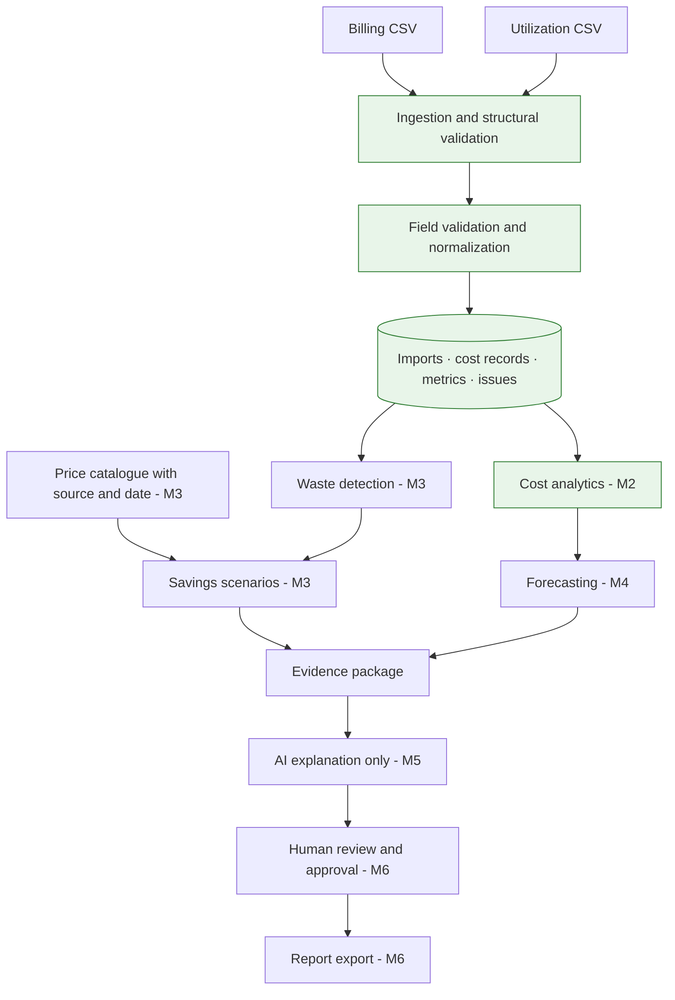

# CloudPilot AI

**AI-assisted cloud cost and resource optimization — local-first, evidence-first, and safe by design.**

CloudPilot AI ingests cloud billing and utilization exports, validates them with
row-level precision, and stores exact-decimal records that later milestones turn
into spend analytics, waste findings, savings scenarios, forecasts and
human-approved optimization plans.

> **Status: Milestones 1–2 (ingestion + cost analytics) are complete.** Findings,
> forecasting, the AI advisor and the dashboard are intentionally not built yet
> — see [Roadmap](#roadmap).
>
> **All sample data is synthetic.** The application holds no cloud credentials
> and cannot create, resize, stop or delete any cloud resource.

---

## The problem

Cloud bills are difficult to interpret and waste is easy to miss. Recruiters and
hiring managers can reproduce every result in this repository in about five
minutes: upload the synthetic billing and utilization files, inspect validation
quality, and see how money is stored exactly rather than through floating point.

The end goal is a FinOps assistant that explains cost drivers, forecasts spend,
and produces **evidence-backed, human-reviewed** savings recommendations. An LLM
will only ever explain numbers that deterministic code already computed.

## What works today

| Capability | Status |
|---|---|
| Generic billing CSV ingestion with row-level validation | ✅ Milestone 1 |
| Generic utilization CSV ingestion with row-level validation | ✅ Milestone 1 |
| Exact `Decimal` money storage (scaled `BIGINT`, no floats) | ✅ Milestone 1 |
| Structural + field + relationship validation, duplicate detection | ✅ Milestone 1 |
| Append-only import audit trail (SHA-256, row counts, raw rows) | ✅ Milestone 1 |
| Paginated import/issue/record inspection API | ✅ Milestone 1 |
| Alembic migrations, SQLite and PostgreSQL, Docker Compose | ✅ Milestone 1 |
| Spend summary, breakdown and trends with exact Decimal aggregation | ✅ Milestone 2 |
| Currency-partitioned totals, business-key de-duplication | ✅ Milestone 2 |
| 49 automated tests | ✅ Milestones 1–2 |
| Findings, price catalogue, savings scenarios | ⏳ Milestone 3 |
| Forecasts with evaluation | ⏳ Milestone 4 |
| Evidence-grounded AI advisor | ⏳ Milestone 5 |
| React dashboard, exports, approvals | ⏳ Milestones 6–7 |

## Architecture



Green nodes are implemented. Detailed design, decisions and trade-offs:
[`docs/ARCHITECTURE.md`](docs/ARCHITECTURE.md).

## Quick start

### Option A — Docker Compose (PostgreSQL)

```bash
docker compose up --build
```

- API: <http://127.0.0.1:8000>
- Interactive docs: <http://127.0.0.1:8000/docs>
- Health: <http://127.0.0.1:8000/api/health>

Containers bind to `127.0.0.1` only. Migrations run automatically at startup.
Upload the host-side sample files with the `curl` commands below.

### Option B — Local Python (SQLite, no Docker)

**Windows PowerShell**

```powershell
python -m venv .venv
.\.venv\Scripts\python.exe -m pip install --upgrade pip
.\.venv\Scripts\python.exe -m pip install -e ".\backend[dev]"

# Database schema (creates/updates the SQLite file at the repository root)
cd backend
..\.venv\Scripts\alembic.exe upgrade head

# Seed the synthetic sample (run from the repository root in a second shell)
cd ..
.\.venv\Scripts\python.exe scripts\seed_sample_data.py

# Start the API
cd backend
..\.venv\Scripts\python.exe -m uvicorn app.main:app --reload
```

**Linux / macOS**

```bash
python3 -m venv .venv
source .venv/bin/activate
pip install --upgrade pip
pip install -e "./backend[dev]"

cd backend
alembic upgrade head
cd ..
python scripts/seed_sample_data.py
cd backend
uvicorn app.main:app --reload
```

Open <http://127.0.0.1:8000/docs>.

If you prefer not to seed the database, upload the CSV files instead:

```powershell
# Windows
curl.exe -s -F "file=@data/sample/billing_sample.csv;type=text/csv" http://127.0.0.1:8000/api/imports/billing
curl.exe -s -F "file=@data/sample/utilization_sample.csv;type=text/csv" http://127.0.0.1:8000/api/imports/utilization
```

```bash
# Linux / macOS
curl -s -F "file=@data/sample/billing_sample.csv;type=text/csv" http://127.0.0.1:8000/api/imports/billing
curl -s -F "file=@data/sample/utilization_sample.csv;type=text/csv" http://127.0.0.1:8000/api/imports/utilization
```

Configuration lives in `.env` (copy `.env.example`). No secrets are required.

## API (Milestones 1–2)

| Method | Endpoint | Purpose |
|---|---|---|
| GET | `/health`, `/api/health` | Liveness/readiness, including database check |
| POST | `/api/imports/billing` | Upload a billing CSV (`?force=true` to bypass hash duplicate check) |
| POST | `/api/imports/utilization` | Upload a utilization CSV |
| GET | `/api/imports` | Paginated history, filter by `kind` and `status` |
| GET | `/api/imports/{id}` | Import status, counts, stats, issue totals |
| GET | `/api/imports/{id}/errors` | Paginated row-level issues, filter by `severity` |
| GET | `/api/imports/{id}/records` | Preview normalized records for audit |
| GET | `/api/costs/summary` | Spend totals by currency, row counts, data window |
| GET | `/api/costs/breakdown` | Spend by `service`, `project`, `region`, `environment`, `provider`, `account` or `resource` |
| GET | `/api/costs/trends` | Daily (`day`) or monthly (`month`) series |

All three cost endpoints accept `start`, `end`, `currency`, `provider`,
`account_id`, `service`, `region`, `environment` and `project`. `breakdown` adds
`dimension` and `limit` (rows per currency, largest first — this is also the
top-cost-driver view). `trends` adds `granularity`. Dates are inclusive.

Example analytics response (abridged):

```json
{
  "window": { "start": "2026-01-01", "end": "2026-03-01", "days": 60 },
  "totals": [{ "currency": "USD", "amount": "1531.305850", "row_count": 480 }],
  "row_count": 480,
  "excluded_duplicate_rows": 0,
  "import_ids": [1],
  "import_count": 1,
  "contains_sample_data": true,
  "notes": [
    "Amounts are exact decimals from imported billing rows; no FX conversion is applied.",
    "Rows are de-duplicated by business key; the earliest stored record wins."
  ]
}
```

Amounts are JSON strings, never floats. Each currency is reported separately;
there is no FX conversion and no combined multi-currency total.

Example upload response (abridged):

```json
{
  "id": 1,
  "kind": "billing",
  "filename": "billing_sample.csv",
  "status": "valid",
  "row_count": 480,
  "accepted_row_count": 480,
  "rejected_row_count": 0,
  "warning_count": 0,
  "currencies": ["USD"],
  "period_start": "2026-01-01",
  "period_end": "2026-03-01",
  "issues": [],
  "issues_truncated": false,
  "message": "Imported 480 rows."
}
```

Errors use one envelope everywhere:

```json
{
  "error": {
    "code": "duplicate_import",
    "message": "This exact file was already imported. Use force=true to import it again.",
    "details": { "import_id": 1, "kind": "billing", "status": "valid" }
  }
}
```

## Data contracts

| Input | Contract | Synthetic samples |
|---|---|---|
| Billing | [`data/schemas/billing.schema.json`](data/schemas/billing.schema.json) | `billing_sample.csv`, `billing_row_errors.csv`, `billing_missing_column.csv`, `billing_multicurrency.csv` |
| Utilization | [`data/schemas/utilization.schema.json`](data/schemas/utilization.schema.json) | `utilization_sample.csv`, `utilization_row_errors.csv` |

Field-by-field rules, error codes and database columns:
[`docs/DATA_DICTIONARY.md`](docs/DATA_DICTIONARY.md). Data policy and currency
assumptions: [`data/README.md`](data/README.md).

CSV requirements: UTF-8 (BOM tolerated), comma-delimited, exact snake_case
headers, ISO dates/timestamps, decimal strings for money. Extra columns are
retained in raw row data but ignored by analysis.

## Correctness guarantees

1. **No binary floating point for money.** `Decimal` is stored as scaled
   `BIGINT` through a SQLAlchemy type decorator. SQL `SUM()` is integer addition,
   so totals are exact on SQLite and PostgreSQL. A test asserts that
   `0.1 + 0.2 + 0.0000005` round-trips as `0.300001`, both through SQLAlchemy and
   through raw SQL.
2. **Currencies are never silently mixed.** Totals are grouped by ISO currency,
   and every record carries its code. A multi-currency file is stored but flagged
   `mixed_currency`. No FX conversion exists, so a USD total and a EUR total are
   never added together.
3. **Bad rows never corrupt good data.** Structural errors reject the whole file.
   Row errors persist only the valid rows and report each rejected row with a
   row number, column, code and message. `CLOUDPILOT_STRICT_IMPORTS=true` switches
   to all-or-nothing.
4. **Replays never double-count.** SHA-256 rejects byte-identical uploads with
   `409`; forced replays are stored for audit but analytics keep only the
   earliest row per business key and report `excluded_duplicate_rows`.
5. **No cloud access.** There is no provider SDK and no write path.

| Situation | Persisted | Status |
|---|---|---|
| All rows valid, no warnings | all rows | `valid` |
| Warnings only | all rows | `valid_with_warnings` |
| Some rows rejected | valid rows only | `partial` |
| Every row rejected / structural failure / strict mode | import audit row only | `invalid` |
| Byte-identical file already imported | nothing new | HTTP `409` |

## Tests

```powershell
cd backend
..\.venv\Scripts\python.exe -m pytest
..\.venv\Scripts\ruff.exe check .
```

Actual result on this machine (Python 3.14.7, 16 Nov 2026):

```text
49 passed, 1 warning in 14.86s
All checks passed!
```

The single warning is an upstream Starlette notice that `httpx` should be
replaced by `httpx2`; it is not from this project. Coverage includes exact
totals against a hand-read CSV fixture, malformed encodings, NUL bytes, oversized
uploads, duplicate headers, missing columns, row limits, duplicate detection,
account masking, strict mode, pagination, transaction integrity, and
hand-calculated analytics totals with per-currency shares and de-duplication.

### Container path verified

On the same machine, `docker compose build` completed and
`docker compose up -d --wait` reported both `db` and `api` as healthy. Uploading
the samples against `http://127.0.0.1:8000` (PostgreSQL 16) returned the same
results as the SQLite run: billing `valid` 480/480, utilization `valid` 2,880/2,880,
malformed billing `partial` 2 accepted / 8 rejected, amounts serialized as
strings, and `alembic_version = 0001`. The analytics endpoints also matched
SQLite exactly (USD `1531.305850`, the same top-five services and the same three
monthly buckets); a forced re-import reported 480 duplicate warnings and
`excluded_duplicate_rows=480` without changing any total. In PostgreSQL,
`cost_records.amount` is stored as `bigint`, so `SUM(amount)` is exact integer
addition. `docker compose config --quiet` also passes.

## 5-minute demo

1. Start the API and open <http://127.0.0.1:8000/docs>.
2. Upload `data/sample/billing_sample.csv`; note `status=valid`, 480 rows,
   a single currency (`USD`) and the data window.
3. Upload `data/sample/utilization_sample.csv`; the 4 resources are recognised
   because billing was loaded first.
4. Upload `data/sample/billing_row_errors.csv`; show `status=partial` and open
   `/api/imports/{id}/errors` to inspect the precise row/column errors.
5. Upload `data/sample/billing_missing_column.csv`; show `status=invalid` and
   that `/records` is empty.
6. Upload the billing file again; show the `409 duplicate_import` with the
   original import ID. Retry with `?force=true` to see overlap warnings.
7. Fetch `/api/imports/{id}/records` and note that amounts are strings such as
   `"4.482123"` — exact decimals, not floats.
8. Open `/api/costs/summary`: USD `1531.305850` over 480 rows for
   `2026-01-01..2026-03-01`. The same total comes from a plain `Decimal` read of
   the CSV, not from the database path.
9. Open `/api/costs/breakdown?dimension=service&limit=5` and
   `/api/costs/trends?granularity=month`; shares are percentages of one currency
   and the three monthly buckets add back to the same total.
10. Run the tests and show the green output above.

Findings, savings, forecasts and AI explanations are not part of Milestones 1–2
and are not simulated in the demo.

## Repository layout

```text
CloudPilot AI/
├── backend/
│   ├── app/
│   │   ├── main.py                 # app factory, lifespan, error envelope
│   │   ├── api/{deps.py,routes/}   # health, import and cost endpoints
│   │   ├── core/                   # settings, enums, errors, UTC helpers
│   │   ├── db/                     # engine, exact decimal types, ORM models
│   │   ├── schemas/                # Pydantic response contracts
│   │   └── services/
│   │       ├── ingestion/          # CSV parser, validators, typed drafts
│   │       ├── imports/            # transaction orchestration + lookups
│   │       └── analytics.py        # Decimal aggregations + de-duplication
│   ├── alembic/                    # migration 0001 initial schema
│   ├── tests/                      # 49 pytest tests
│   └── pyproject.toml
├── data/
│   ├── sample/                     # synthetic valid + malformed CSVs
│   ├── schemas/                    # CSV JSON contracts
│   └── README.md
├── docs/
│   ├── IMPLEMENTATION_PLAN.md
│   ├── ARCHITECTURE.md
│   ├── DATA_DICTIONARY.md
│   └── THREAT_MODEL.md
├── pricing/
│   ├── sources.md                  # provenance rules (catalogue empty until M3)
│   └── catalogue/
├── scripts/
│   ├── generate_sample_data.py     # deterministic synthetic data
│   └── seed_sample_data.py         # load sample into the configured DB
├── Dockerfile
├── docker-compose.yml
├── .env.example
└── README.md
```

## Roadmap

| Milestone | Scope | Exit check |
|---|---|---|
| ✅ **M1** | Ingestion, validation, exact-decimal storage, import audit | Totals exact; malformed rows reported precisely |
| ✅ **M2** | Decimal spend summaries, trends, breakdowns with currency partitioning and business-key de-duplication | Totals and groupings match hand-calculated fixtures |
| **M3** | Idle/over-provisioned detection rules, sourced price catalogue, savings scenarios | Every finding links to evidence; every saving is reproducible |
| **M4** | Transparent forecasting with train/test split and error metrics | Forecast reproducible and evaluated |
| **M5** | Evidence-bounded AI advisor (local model preferred), typed output, injection tests | AI explains without inventing prices or changing totals |
| **M6** | React dashboard, filters, sample-data badge, approvals, exports | Full workflow in the browser |
| **M7** | CI, release hardening, screenshots, `v1.0.0` | `docker compose up --build` demo passes from scratch |

Details and open questions: [`docs/IMPLEMENTATION_PLAN.md`](docs/IMPLEMENTATION_PLAN.md).

## Security posture

- No cloud credentials, provider SDKs or write operations exist.
- Upload size, row count, encoding and numeric ranges are bounded.
- SQL is parameterized through SQLAlchemy; filenames are reduced to a basename.
- 12-digit account IDs are masked before storage.
- CSV content is inert text; it is never executed. AI prompt-injection defenses
  arrive with the advisor in Milestone 5.
- The API has **no authentication** and binds locally. Do not expose it to a
  network until M7 hardening lands.

Full STRIDE-style analysis: [`docs/THREAT_MODEL.md`](docs/THREAT_MODEL.md).

## Known limitations (Milestones 1–2)

- Analytics are read-only and computed on demand; there is no materialized cache.
  Fine at local sample sizes, but large exports will need pre-aggregation.
- De-duplication matches the exact business key
  (`usage_date, provider, account_id, service, resource_id, usage_unit, amount`).
  A restated export with a *changed* amount is a new key and is counted in
  addition to the original; supersede/version semantics are not implemented.
- Breakdowns apply `limit` per currency, so a multi-currency response can contain
  more than `limit` items in total.
- Shares are rounded to three decimal places per row; they may not sum to exactly
  `100.000` when many small groups exist.
- No authentication, rate limiting or TLS.
- No UI yet; use `/docs` or `curl`.
- Imports are append-only; there is no rollback/delete endpoint.
- `usage_unit` is shape-checked, not validated against a per-service allowlist.
- Utilization metrics reference billing resources by string ID; there is no
  resource inventory table yet.
- SQLite is fine for one local user; PostgreSQL is recommended for concurrency.
- The container image runs on Python 3.12 while local development used 3.14.7;
  both pass the same HTTP checks, but the test suite is executed on the host.
- No CI pipeline yet; tests and lint are run manually.

## Documentation

- [Architecture and decisions](docs/ARCHITECTURE.md)
- [Implementation plan and open questions](docs/IMPLEMENTATION_PLAN.md)
- [Data dictionary and error codes](docs/DATA_DICTIONARY.md)
- [Threat model](docs/THREAT_MODEL.md)
- [Data policy and synthetic-data notice](data/README.md)
- [Pricing provenance rules](pricing/sources.md)
