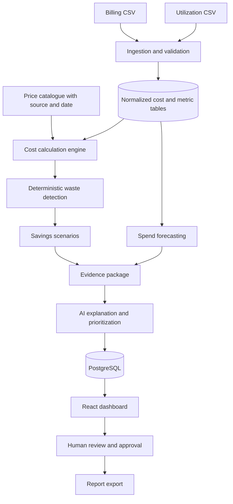
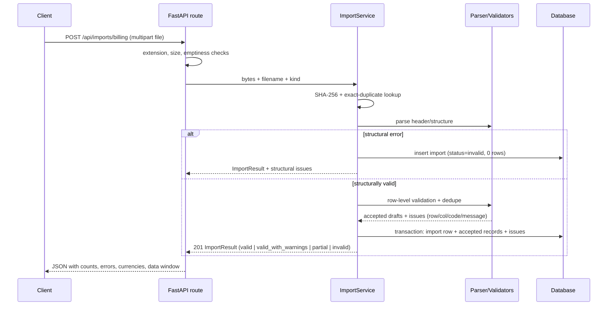
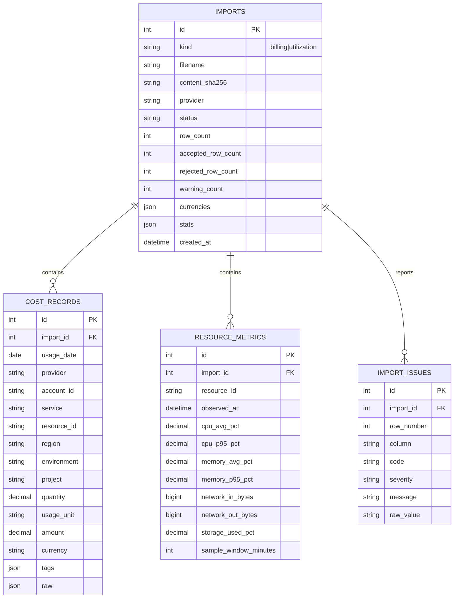
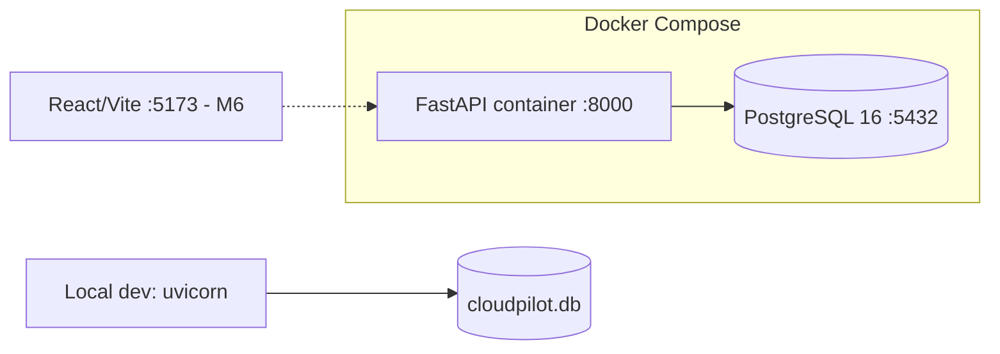

# CloudPilot AI — Architecture

## 1. Purpose

CloudPilot AI is a local-first FinOps assistant. It ingests cloud billing and
utilization exports, normalizes them, computes transparent cost and savings
analysis, and produces human-reviewed optimization plans. It never mutates cloud
resources.

**Core principle:** deterministic code calculates; the AI explains. An LLM may
never introduce a price, total or saving that is not present in the supplied
evidence package.

## 2. Context diagram



Milestone 1 implements the left-hand slice: upload → validation → normalization
→ persistence → auditable errors. Everything to the right of `F` is planned.

## 3. Current repository layout

```text
CloudPilot AI/
├── backend/
│   ├── alembic/                 # migrations (0001 initial schema)
│   ├── app/
│   │   ├── main.py              # app factory, lifespan, exception handlers
│   │   ├── api/routes/          # health.py, imports.py
│   │   ├── core/
│   │   │   ├── config.py        # typed settings (pydantic-settings)
│   │   │   ├── errors.py        # AppError taxonomy + error envelope
│   │   │   └── time.py          # UTC helpers
│   │   ├── db/
│   │   │   ├── base.py          # Base, engine/session factory, get_db
│   │   │   └── models.py        # ORM tables
│   │   ├── schemas/             # Pydantic request/response models
│   │   ├── services/ingestion/  # csv_reader, validators, billing, utilization
│   │   └── services/imports/    # import orchestration + queries
│   ├── tests/                   # pytest suite + fixtures
│   └── pyproject.toml
├── data/
│   ├── sample/                  # synthetic valid + deliberately invalid CSVs
│   ├── schemas/                 # machine-readable CSV contracts
│   └── README.md                # data policy + synthetic-data notice
├── docs/                        # this file + plan, dictionary, threat model
├── pricing/                     # catalogue placeholder + sources.md
├── scripts/                     # sample-data generator + seed script
├── docker-compose.yml
├── Dockerfile
└── README.md
```

The guide's suggested `services/normalization`, `costing`, `detection`,
`forecasting`, `recommendations` packages are intentionally **not** created yet.
Empty scaffolding suggests functionality that does not exist; each is added with
its milestone.

## 4. Request flow: CSV import



### Transaction and status semantics

| Situation | Persistence | Status | HTTP |
|---|---|---|---|
| All rows valid, no warnings | all rows | `valid` | 201 |
| All rows valid, warnings only | all rows | `valid_with_warnings` | 201 |
| Some rows rejected | valid rows only | `partial` | 201 |
| Every row rejected | import header only | `invalid` | 201 |
| Missing columns / bad encoding / too large | import header only | `invalid` | 201 / 413 |
| Byte-identical file already imported | nothing new | — | 409 |
| Strict mode + any row error | import header only | `invalid` | 201 |

An import record is always written so failed attempts are auditable. `201`
means "an import attempt was recorded", and the `status` field is authoritative.
The only pre-import rejections are transport-level: wrong extension (415), empty
file (422), oversized file (413) and exact duplicate (409).

## 5. Layers and boundaries

| Layer | Responsibility | Must not |
|---|---|---|
| `api/routes` | HTTP concerns, status codes, pagination | contain business rules |
| `schemas` | Typed contracts, JSON shapes | touch the DB |
| `services/ingestion` | Parsing, validation, normalization | perform commits |
| `services/imports` | Orchestration, transaction boundary, audit | parse CSV syntax |
| `db` | Persistence, exact types | know about HTTP |
| `llm` (M5) | Explanation only | calculate or mutate data |

Dependency direction is one-way: `api → services → db/schemas`. Ingestion
services are pure functions of `(bytes, settings)`, which is why they are cheap
to unit-test without a database.

## 6. Validation pipeline

1. **Transport** — `.csv` extension, non-empty, ≤ `CLOUDPILOT_MAX_UPLOAD_BYTES`.
2. **Decode** — UTF-8 (BOM tolerated); decode failure is structural.
3. **Structure** — delimiter, duplicate/blank headers, required column set,
   row field count, row limit (`CLOUDPILOT_MAX_ROWS`).
4. **Field** — strict ISO dates, `Decimal` parsing (no NaN/Inf), ranges, enum
   membership, currency allowlist, account-id shape/masking.
5. **Relationship** — within-file duplicate business keys (error); utilization
   resource IDs absent from billing (warning); cross-import overlaps (warning).
6. **Persist** — one transaction; issues capped at
   `CLOUDPILOT_MAX_ERRORS_PER_IMPORT` with a truncation flag.

Every issue has `row_number` (1-based data row, header excluded), `column`,
`code`, `message`, `severity` and a truncated `raw_value`. Error codes are
catalogued in `docs/DATA_DICTIONARY.md`.

## 7. Data model (Milestone 1 subset)



The guide names the import table `billing_imports`. Because utilization files
need the same audit metadata, this implementation generalizes it to `imports`
with a `kind` column. See ADR-004.

## 8. Architecture decisions

| ID | Decision | Rationale | Consequence |
|---|---|---|---|
| ADR-001 | SQLite default, PostgreSQL in Compose | Zero-setup reviewer experience; production parity available | SQL dialect differences must be avoided in queries |
| ADR-002 | Money stored as scaled `BIGINT` via `TypeDecorator` | SQLite has no decimal type; floats lose cents | Analytics can `SUM` exactly; 6 dp precision |
| ADR-003 | stdlib `csv`, not pandas, for ingestion | Precise row/column error reporting; no dtype coercion; smaller image | pandas may still be used later for analytics |
| ADR-004 | Single `imports` table with `kind` | Avoids duplicated audit schema | Deviates from guide's `billing_imports` name |
| ADR-005 | App factory + settings injection | Tests get isolated DBs; no global mutable state | `create_app(settings)` is the only entry point |
| ADR-006 | Partial imports by default | Real exports often contain a few bad rows | Totals must be read alongside import status |
| ADR-007 | Append-only imports | Audit trail integrity | No delete/rollback endpoint in M1 |
| ADR-008 | UTC everywhere | Avoid DST ambiguity in cost windows | Naive input timestamps are treated as UTC and flagged in docs |

## 9. Deployment



- Local dev: `uvicorn app.main:app --reload` against SQLite.
- Compose: `docker compose up --build` runs migrations then serves the API.
- Production expectations (later): non-root container, `CLOUDPILOT_AUTO_CREATE_TABLES=false`,
  secrets from environment, reverse proxy with TLS, authentication in front of
  all `/api` routes.

## 10. Extensibility

- **New provider export** → new parser module under `services/ingestion/` that
  emits the same normalized draft objects; no schema change for the core.
- **New detection rule** → pure function over `(cost records, metrics, price
  entries)` returning findings with evidence IDs (Milestone 3).
- **New LLM provider** → adapter implementing the same typed interface, with
  schema validation at the boundary (Milestone 5).
- **New currency** → add to the allowlist and ensure the aggregation layer
  partitions by currency; no silent conversion.
