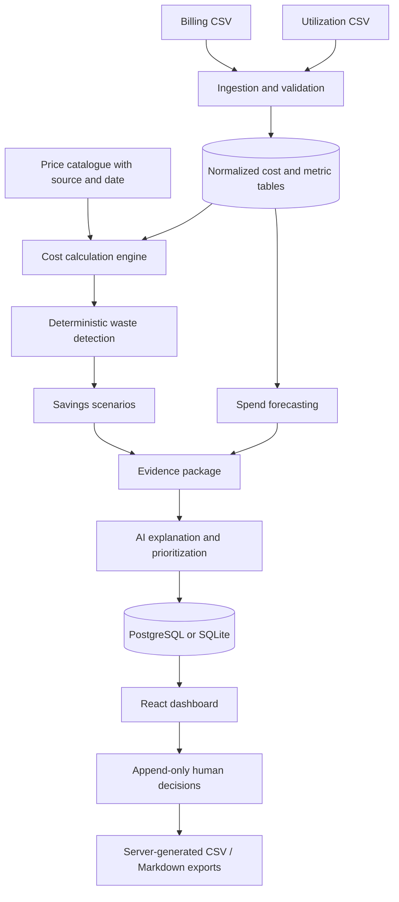
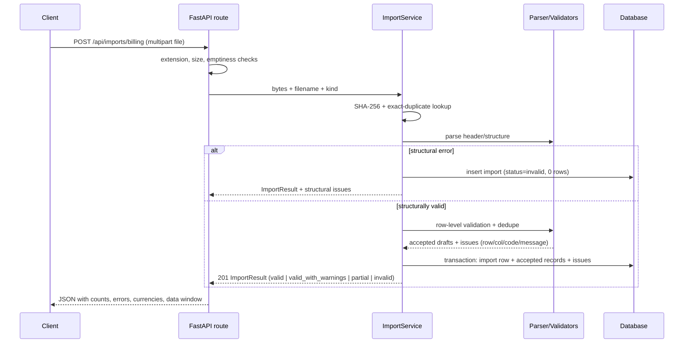
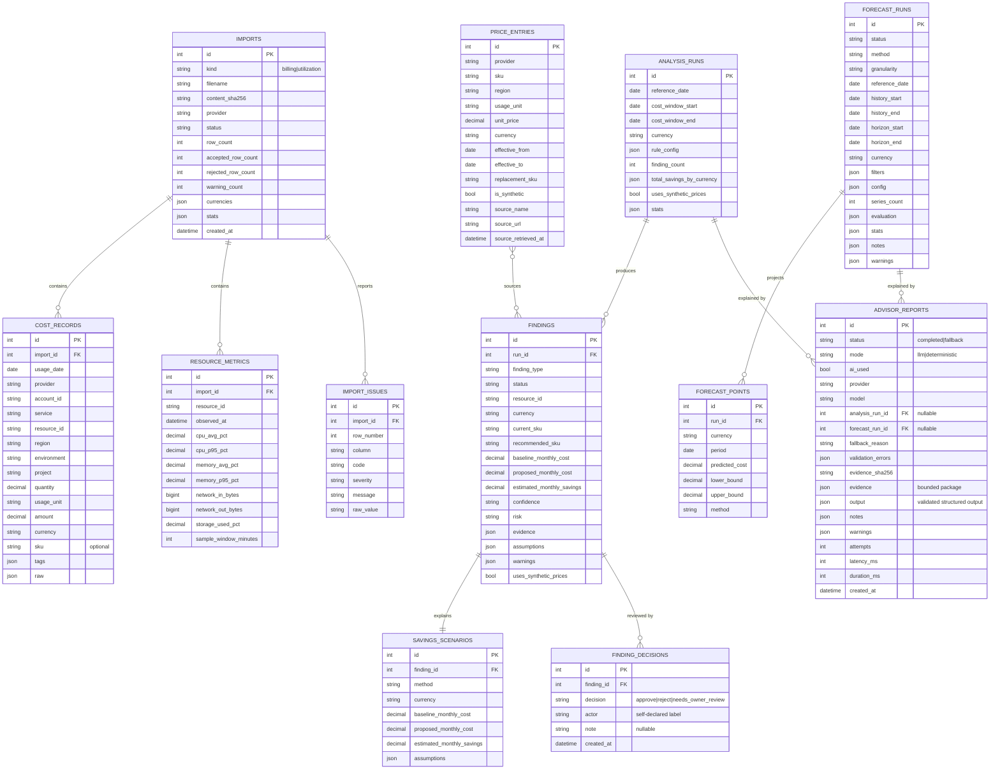
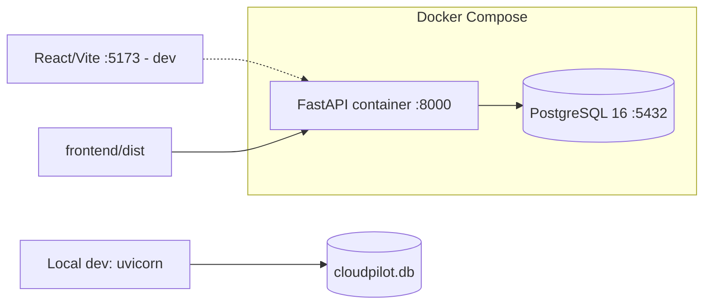

# CloudPilot AI — Architecture

## 1. Purpose

CloudPilot AI is a local-first FinOps assistant. It ingests cloud billing and
utilization exports, normalizes them, computes transparent cost and savings
analysis, and produces human-reviewed optimization plans. It never mutates cloud
resources.

**Core principle:** deterministic code calculates; the AI explains. An LLM may
never introduce a price, total or saving that is not present in the supplied
evidence package.

## 2. Context diagram



Milestones 1–6 implement the full left-to-right slice: upload → validation →
normalization → persistence → cost analytics → waste detection and savings
scenarios → spend forecasting → evidence-bound explanation → dashboard →
append-only decisions → exports. Milestone 7 is release hardening only.

## 3. Current repository layout

```text
CloudPilot AI/
├── backend/
│   ├── alembic/                 # migrations 0001–0005 (review decisions)
│   ├── app/
│   │   ├── main.py              # app factory, lifespan, handlers, optional SPA mount
│   │   ├── api/routes/          # health, imports, costs, prices, analysis, forecasts,
│   │   │                        # reports, decisions, resources, filters, exports
│   │   ├── core/
│   │   │   ├── config.py        # typed settings (pydantic-settings)
│   │   │   ├── enums.py         # shared enums (finding type, decision kind, risk)
│   │   │   ├── errors.py        # AppError taxonomy + error envelope
│   │   │   └── time.py          # UTC helpers
│   │   ├── db/
│   │   │   ├── base.py          # Base, engine/session factory, get_db
│   │   │   └── models.py        # ORM tables
│   │   ├── llm/
│   │   │   ├── client.py        # OpenAI-compatible stdlib client (retries, limits)
│   │   │   └── prompts.py       # system/user prompts, required JSON shape
│   │   ├── schemas/             # Pydantic request/response models
│   │   ├── services/analytics.py # Decimal spend aggregation + de-duplication
│   │   ├── services/analysis.py  # idle/rightsize rules, evidence, scenarios
│   │   ├── services/forecasting.py # daily baselines, holdout metrics, intervals
│   │   ├── services/advisor.py   # package, redaction, validation, fallback
│   │   ├── services/decisions.py # append-only decisions + latest lookup
│   │   ├── services/resources.py # utilization inventory aggregate
│   │   ├── services/filters.py   # filter discovery + freshness
│   │   ├── services/exports.py   # Excel-safe CSV + Markdown report
│   │   ├── services/prices.py    # catalogue loader, provenance, lookup
│   │   ├── services/ingestion/  # csv_reader, validators, billing, utilization
│   │   └── services/imports/    # import orchestration + queries
│   ├── tests/                   # pytest suite + fixtures
│   └── pyproject.toml
├── frontend/
│   ├── src/
│   │   ├── App.tsx              # HashRouter + eight routes
│   │   ├── api/                 # typed client, abortable query/action hooks, types
│   │   ├── components/          # Layout, UI primitives, Recharts wrappers
│   │   ├── lib/money.ts         # BigInt exact formatting; floats only for charts
│   │   ├── pages/               # overview, costs, resources, findings, advisor,
│   │   │                        # forecasts, imports, audit
│   │   ├── state/AppState.tsx   # health, filters, display currency
│   │   └── styles.css           # hand-written design system
│   ├── vite.config.ts           # /api dev proxy + Vitest jsdom config
│   └── package.json
├── data/
│   ├── sample/                  # synthetic valid + deliberately invalid CSVs
│   ├── schemas/                 # machine-readable CSV contracts
│   └── README.md                # data policy + synthetic-data notice
├── docs/                        # this file + plan, dictionary, threat model
├── pricing/
│   ├── catalogue/demo_prices.csv # clearly labelled synthetic demo catalogue
│   └── sources.md               # provenance rules
├── scripts/                     # sample-data generator + seed script
├── docker-compose.yml
├── Dockerfile
└── README.md
```

The guide's suggested LLM/recommendations scaffolding was intentionally not created
up front. Each package is added with its milestone: `forecasting.py` with M4,
`advisor.py` + `llm/` with M5, and `decisions.py`/`resources.py`/`filters.py`/
`exports.py` with M6.

## 4. Request flow: CSV import



### Transaction and status semantics

| Situation | Persistence | Status | HTTP |
|---|---|---|---|
| All rows valid, no warnings | all rows | `valid` | 201 |
| All rows valid, warnings only | all rows | `valid_with_warnings` | 201 |
| Some rows rejected | valid rows only | `partial` | 201 |
| Every row rejected | import header only | `invalid` | 201 |
| Missing columns / bad encoding / too large | import header only | `invalid` | 201 / 413 |
| Byte-identical file already imported | nothing new | — | 409 |
| Strict mode + any row error | import header only | `invalid` | 201 |

An import record is always written so failed attempts are auditable. `201`
means "an import attempt was recorded", and the `status` field is authoritative.
The only pre-import rejections are transport-level: wrong extension (415), empty
file (422), oversized file (413) and exact duplicate (409).

## 5. Layers and boundaries

| Layer | Responsibility | Must not |
|---|---|---|
| `api/routes` | HTTP concerns, status codes, pagination | contain business rules |
| `schemas` | Typed contracts, JSON shapes | touch the DB |
| `services/ingestion` | Parsing, validation, normalization | perform commits |
| `services/imports` | Orchestration, transaction boundary, audit | parse CSV syntax |
| `services/analytics` | Read-only Decimal aggregation, de-duplication | mutate data or call an LLM |
| `services/analysis` | Deterministic rules, evidence, savings scenarios | invent SKUs, prices or savings; call an LLM |
| `services/forecasting` | Deterministic daily baselines, holdout evaluation, intervals | invent history, mix currencies, call an LLM |
| `services/prices` | Catalogue validation, provenance, exact lookup | fetch live provider prices or guess a fallback |
| `db` | Persistence, exact types | know about HTTP |
| `llm` (M5) | Explanation only | calculate or mutate data |

Dependency direction is one-way: `api → services → db/schemas`. Ingestion
services are pure functions of `(bytes, settings)`, which is why they are cheap
to unit-test without a database.

## 6. Validation pipeline

1. **Transport** — `.csv` extension, non-empty, ≤ `CLOUDPILOT_MAX_UPLOAD_BYTES`.
2. **Decode** — UTF-8 (BOM tolerated); decode failure is structural.
3. **Structure** — delimiter, duplicate/blank headers, required column set,
   row field count, row limit (`CLOUDPILOT_MAX_ROWS`).
4. **Field** — strict ISO dates, `Decimal` parsing (no NaN/Inf), ranges, enum
   membership, currency allowlist, account-id shape/masking.
5. **Relationship** — within-file duplicate business keys (error); utilization
   resource IDs absent from billing (warning); cross-import overlaps (warning).
6. **Persist** — one transaction; issues capped at
   `CLOUDPILOT_MAX_ERRORS_PER_IMPORT` with a truncation flag.

Every issue has `row_number` (1-based data row, header excluded), `column`,
`code`, `message`, `severity` and a truncated `raw_value`. Error codes are
catalogued in `docs/DATA_DICTIONARY.md`.

### 6.1 Analytics query path (Milestone 2)

`services/analytics.py` turns a `CostScope` (inclusive dates + dimension filters)
into three read-only responses. There is no cache and no write path.

```text
GET /api/costs/{summary|breakdown|trends}
        |
        v
CostScope -> SQL filters -> business-key de-duplication -> GROUP BY
        |                                                        |
        |                                          currency, dimension/bucket
        v                                                        v
  effective window                              integer SUM(micros)
                                                         |
                                               Decimal(scale -6)
                                                         |
                                          Pydantic JSON (string amounts)
```

Key properties:

- **Exact sums.** `amount` is stored as scaled `BIGINT`; every aggregate uses
  `SUM(CAST(amount AS BIGINT))` and converts the integer to `Decimal` in Python.
  No `float` is created at any point.
- **Currency partitioning.** Every `GROUP BY` includes `currency`; responses
  contain per-currency totals and shares. A multi-currency response never exposes
  a combined total.
- **Business-key de-duplication.** A scalar subquery keeps
  `MIN(id)` per `(usage_date, provider, account_id, service, resource_id,
  usage_unit, amount)`; later re-imports are stored but excluded. The response
  reports `excluded_duplicate_rows`, so the adjustment is visible rather than
  silent.
- **Stable bucketing.** Daily rows are aggregated in SQL; month rollup happens in
  Python with `Decimal` addition, avoiding dialect-specific date functions.
- **Rounding.** Group shares are quantized to 3 decimal places with `ROUND_HALF_UP`;
  totals stay at 6 decimal places and are never re-rounded.

### 6.2 Waste detection path (Milestone 3)

`services/analysis.py` is a deterministic batch job over already-imported data.

```text
POST /api/analysis/run
        |
        v
scope -> latest usage_date -> 30-day cost window -> de-duplicated billing rows
                                               |
                    group by resource -------+------ utilization samples in the
                                               |       same window
                                               v
                          idle rule OR rightsize rule
                                               |
                         exact price lookup (same provider/region/
                         currency/unit, effective on window end)
                                               |
                                               v
                       findings + one savings scenario per finding
                       (baseline, proposed, savings, evidence IDs,
                        assumptions, warnings, confidence, risk)
```

Rules and guarantees:

- **Idle** requires every observed CPU p95 sample below 15% **and** every memory
  p95 sample below 30%. Savings assume a full-window stop with zero replacement
  cost, so `proposed = 0` and `savings = baseline`.
- **Rightsize** requires mean CPU below 50% and mean memory below 70%, plus an
  explicit billing `sku` and a catalogue `replacement_sku`. The proposal scales
  the billing baseline by the exact list-price ratio:
  `proposed = baseline × replacement_price / current_price`.
- **No inference.** A missing SKU, missing price, mixed currency or insufficient
  observation produces no finding. The run's `stats.skipped` count and notes
  disclose what was skipped; no price or saving is invented.
- **Evidence.** Each finding stores capped cost-record and metric IDs plus counts,
  import IDs, the cost window, the observation window and the rule configuration.
- **Currency.** One finding never spans currencies, and run totals are a
  per-currency map that must not be added together.
- **Reproducibility.** Runs are immutable. Repeating a run creates new finding
  rows with identical arithmetic; old runs remain queryable by `run_id`.
- **Synthetic provenance.** A finding that used a synthetic catalogue entry sets
  `uses_synthetic_prices=true` and includes a warning. The run is flagged too.

### 6.3 Spend forecasting path (Milestone 4)

`services/forecasting.py` is a deterministic, read-only model over de-duplicated
billing. It never calls an AI or cloud API.

```text
POST /api/forecasts/run
        |
        v
scope filters -> business-key de-duplication -> daily SUM(micros) per currency
        |                                              |
        |                                    zero-fill missing calendar days
        v                                              v
  max usage_date (reference)              train = history - holdout
        |                                              |
        |                          seasonal naive or moving average
        |                                              |
        |                          holdout predictions (no future leakage)
        |                                              v
        |                    MAE, RMSE, bias, MAPE, empirical residual quantile
        v                                              |
  horizon = reference + 1 .. + N                        v
        |                              forecast_points + immutable forecast_run
        v
  projected total/lower/upper per currency, warnings, notes, confidence
```

Guarantees:

- **No leakage.** The holdout tail is predicted from earlier values only; the
  model is then refitted on all history for the future horizon.
- **Seasonal naive.** Each future day equals the same weekday seven days earlier,
  recursively for horizons beyond seven days.
- **Moving average.** A flat mean of the last *N* observed days; the response
  warns that weekly seasonality is not modelled.
- **Empirical interval.** Width is the configured quantile (default 90%) of
  absolute holdout residuals. It is not a calibrated Gaussian interval, and the
  warning list says so when the horizon exceeds the holdout.
- **Explicit failure.** Fewer than 28 days, a holdout that consumes all history,
  or no matching billing rows returns `409` with a machine-readable reason
  instead of a guessed forecast.
- **Currency isolation.** Every series, projection and total is per currency;
  there is no combined total and no FX.
- **Reproducibility.** Runs and points are immutable. Repeating a request creates
  a new run with identical arithmetic; old runs remain queryable by `run_id`.

### 6.4 Evidence-bound advisor path (Milestone 5)

`services/advisor.py` packages deterministic results, optionally calls one
OpenAI-compatible endpoint, validates the prose and persists the outcome. The
default path is local-only.

```text
POST /api/reports/generate
        |
        v
 latest analysis_run (findings + scenarios) --.
 latest forecast_run (evaluation + series) ---+--> bounded package builder
                                                   |
                                      redact free text, cap findings/strings
                                                   |
                                      canonical JSON + SHA-256
                                                   |
                     advisor disabled? ------------+--> deterministic output
                     no key / insecure URL? ------+
                                                   |
                                      HTTPS OpenAI-compatible POST
                                                   |
                                JSON mode, timeout, bounded retries
                                                   |
                              Pydantic schema -> evidence-ID check
                                                   |
                              numeric-claim check against package
                                                   |
                         accept, or discard and use deterministic output
                                                   v
                                 immutable advisor_reports row
```

Guarantees:

- **The model cannot change numbers.** It receives a read-only package; accepted
  prose is stored beside the package, not in findings or forecast tables.
- **No raw data by default.** Packages exclude CSV bytes, tags, upload rows and
  accounts. Free text is stripped of control characters, emails and long digit
  runs, and instruction-like phrasing becomes `[redacted untrusted text]`.
- **Strict acceptance.** Unknown or duplicate finding/evidence IDs, absent
  numeric claims, missing priority findings, `human_review_required != true` and
  schema violations all discard the model answer and record a reason code.
- **Bounded transport.** HTTPS (HTTP only on localhost), 30 s default timeout,
  bounded retries for transient statuses, a response-size cap and no streaming.
- **Auditable snapshots.** Each report stores the exact package, its SHA-256,
  notes, warnings, attempts and latency. `GET /api/reports/{id}` returns both the
  output and the package a reviewer can re-check.
- **Same package on both engines.** The sample data produced an identical
  `evidence_sha256` on SQLite and PostgreSQL 16.

### 6.5 Dashboard, decisions and exports (Milestone 6)

```text
browser (React SPA, HashRouter)
   |
   +-- GET /api/filters ---------> distinct values + window + import freshness
   +-- GET /api/costs/* ---------> exact decimal summaries (BigInt formatting)
   +-- GET /api/resources -------> utilization aggregate + owner tags
   +-- POST /api/analysis/run ---> deterministic findings
   +-- POST /api/findings/{id}/decision --> append-only row
   +-- GET /api/decisions -------> audit trail + latest decision join
   +-- POST /api/reports/generate -> advisor or deterministic fallback
   +-- GET /api/exports/findings.csv --> sanitized CSV (attachment, nosniff)
   +-- GET /api/exports/summary.md ---> Markdown report (attachment, nosniff)
```

Design notes:

- **Serving.** `GET /` returns `frontend/dist/index.html` when the build exists
  (`CLOUDPILOT_FRONTEND_DIST_DIR` overrides the path); otherwise it returns the API
  banner JSON. `/api/*` and `/docs` are unaffected. Hashed Vite assets are served
  from the same origin, so no CORS or SPA rewrite rules are required at runtime.
- **Exact rendering.** The SPA receives decimal strings and formats them with
  `BigInt`, never `parseFloat` for displayed money. Floats are confined to chart
  axis ticks and labels, which are marked approximate.
- **Append-only decisions.** `POST /api/findings/{id}/decision` inserts a row and
  returns `201`; it never updates a finding. Listing findings joins the newest
  decision per finding. The audit page reads `/api/decisions` with context fields
  copied at read time from the immutable finding.
- **Read-only resource health.** `/api/resources` re-uses the analysis thresholds
  only for pre-check badges. It does not create findings, savings or decisions.
- **Exports.** CSV generation sanitizes formula-leading cells, quotes per RFC 4180
  via the stdlib `csv` writer and emits one row per finding per currency. The
  Markdown report is assembled from stored totals, findings, latest decisions, the
  newest forecast and import lineage, with an explicit synthetic-data notice.

## 7. Data model



The guide names the import table `billing_imports`. Because utilization files
need the same audit metadata, this implementation generalizes it to `imports`
with a `kind` column. See ADR-004.

## 8. Architecture decisions

| ID | Decision | Rationale | Consequence |
|---|---|---|---|
| ADR-001 | SQLite default, PostgreSQL in Compose | Zero-setup reviewer experience; production parity available | SQL dialect differences must be avoided in queries |
| ADR-002 | Money stored as scaled `BIGINT` via `TypeDecorator` | SQLite has no decimal type; floats lose cents | Analytics can `SUM` exactly; 6 dp precision |
| ADR-003 | stdlib `csv`, not pandas, for ingestion | Precise row/column error reporting; no dtype coercion; smaller image | pandas may still be used later for analytics |
| ADR-004 | Single `imports` table with `kind` | Avoids duplicated audit schema | Deviates from guide's `billing_imports` name |
| ADR-005 | App factory + settings injection | Tests get isolated DBs; no global mutable state | `create_app(settings)` is the only entry point |
| ADR-006 | Partial imports by default | Real exports often contain a few bad rows | Totals must be read alongside import status |
| ADR-007 | Append-only imports | Audit trail integrity | No delete/rollback endpoint in M1 |
| ADR-008 | UTC everywhere | Avoid DST ambiguity in cost windows | Naive input timestamps are treated as UTC and flagged in docs |
| ADR-009 | Billing duplicates stored but excluded from analytics | Corrected exports remain importable while totals stay single-counted | Changed-amount restatements are new business keys; supersede semantics postponed |
| ADR-010 | Analytics partition every aggregate by currency | Prevents silent FX mixing | Multi-currency responses need per-currency presentation in the UI |
| ADR-011 | Waste rules are fixed thresholds stored in settings | Explainable and testable; no opaque model | Not statistical anomaly detection |
| ADR-012 | Rightsizing uses a catalogue price ratio | Avoids inventing a SKU price; exact `Decimal` arithmetic | Requires billing `sku` and catalogue `replacement_sku`; list prices only |
| ADR-013 | Every price row carries provenance and an `is_synthetic` flag | Demo prices can never be mistaken for vendor quotes | Synthetic catalogue is deliberately obvious (`example.invalid`) |
| ADR-014 | Analysis runs and findings are immutable | Savings stay auditable and reproducible | Re-running creates new rows; no in-place edit API |
| ADR-015 | The LLM adapter uses stdlib `urllib` against one OpenAI-compatible endpoint | Zero SDK dependency, any free provider, easy to audit | No provider-specific features; JSON mode must be supported or disabled |
| ADR-016 | Model output is strictly validated against the package, then discarded on failure | AI can explain but never invent or mutate amounts | Some legitimate prose is rejected by design; deterministic fallback always exists |
| ADR-017 | Advisor is opt-in and off by default; only a redacted derived package can leave | Local-first default and free-tier friendly | Users must configure a key; live vendor behaviour is not pre-verified |
| ADR-018 | Advisor reports are immutable snapshots including the exact package hash | A reviewer can reproduce or reject an explanation | No delete endpoint; storage grows with report count |
| ADR-019 | Human decisions are append-only `finding_decisions` rows | Review history can never be rewritten; findings stay immutable | UI shows the newest decision; full trail lives in `/api/decisions` |
| ADR-020 | Resource-health flags are pre-checks, not findings | Keeps exploratory inventory separate from money-bearing, evidence-linked findings | Users may see an idle flag without a matching finding (e.g. below the savings floor) |
| ADR-021 | Exports are generated on the server | One sanitization/formatting path, testable headers, consistent decimals | Browser downloads a file; no client-side CSV generation |
| ADR-022 | The SPA formats money with `BigInt` from decimal strings | Preserves the exact-money guarantee in the UI | Floats are allowed only for chart geometry and are labelled approximate |
| ADR-023 | The SPA is served optionally from the API origin | One command and one port for reviewers; Vite still supports hot reload | Requires a build step for the single-origin mode; no SSR |

## 9. Deployment



- Local dev: `uvicorn app.main:app --reload` against SQLite.
- Dashboard dev: `npm run dev` on `:5173`, with `/api` proxied to `:8000`.
- Dashboard single origin: `npm run build`, then restart the API; `/` serves
  `frontend/dist/index.html`, and hashed assets are served from the same origin.
- Compose: `docker compose up --build` runs migrations then serves the API.
- Production expectations (later): non-root container, `CLOUDPILOT_AUTO_CREATE_TABLES=false`,
  secrets from environment, reverse proxy with TLS, authentication in front of
  all `/api` routes.

## 10. Extensibility

- **New provider export** → new parser module under `services/ingestion/` that
  emits the same normalized draft objects; no schema change for the core.
- **New detection rule** → pure function over `(cost records, metrics, price
  entries)` returning findings with evidence IDs, registered in
  `services/analysis.py`; the result schema already carries assumptions,
  warnings and provenance.
- **New LLM provider** → configure an OpenAI-compatible base URL/model in `.env`;
  the adapter, validation and fallback stay unchanged.
- **New currency** → add to the allowlist and ensure the aggregation layer
  partitions by currency; no silent conversion.
